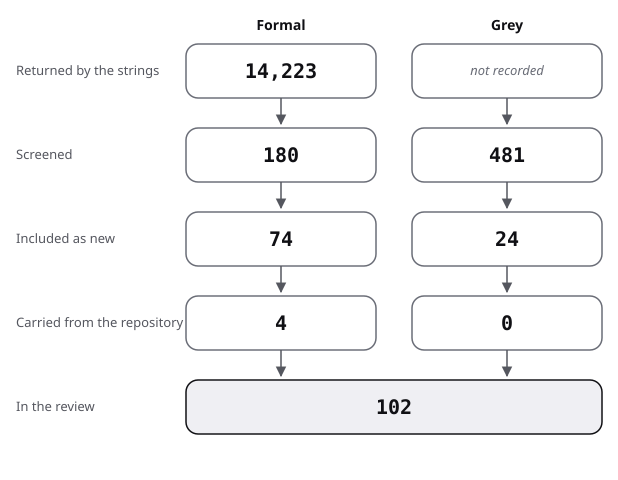

# Sources: the pool, the flow and the scores

This is the pool of the algorithm-design review: the flow of screening, then one row per source with its kind, route found, quality and use. Method and strings are in [protocol](protocol.md).

## Flow

| Stage | Formal | Grey |
|---|---|---|
| Returned by the strings | 14,223 | not recorded |
| Screened | 180 | 481 |
| Included as new | 74 | 24 |
| Carried from the repository | 4 | 0 |
| In the review | 78 | 24 |

- Formal:
  - 14,223 records were returned: 12,845 by the Semantic Scholar bulk search (18 strings, F1 to F18) and 1,378 by the arXiv API; repeats across strings are not removed.
  - 180 were screened by title: the 10 most cited of each string's Semantic Scholar list.
  - 16 of the 74 new sources were included from those titles.
  - 58 came from leads named in the brief or recalled by the reviewer and verified, from the searches for existing reviews (R1 to R8), and from snowballing in Liu 2024.
  - The arXiv hits were not screened; they gave counts and a few leads that were checked directly.
  - Exclusions by title, rounded to tens (164 titles, repeats across strings not removed):
    - 60 off topic by word match (chemistry, physics, economics, electronics, imaging, wireless, linguistics);
    - 60 in the field but outside the question (verification, analysis and test tools, multi-agent code generation, modelling languages);
    - 50 relevant but located only (teaching papers on plans and recipes, benchmark and tool papers on Dafny, spec-driven preprints, older textbooks), not read because their title does not settle relevance.
  - 4 sources are carried from other topics and used by link: Garousi 2019, Newcombe 2015, Wirth 1971, Soloway 1984.
- Grey:
  - The web search returned no total that was recorded; the Q/A strings returned 414 records (repeats included).
  - 481 were screened: 414 Q/A records, 59 web results (first page of five strings, G1 to G5) and 8 direct visits to named producers or counts.
  - 24 were included: 8 web or repository sources and 16 Q/A threads.
  - Web results excluded: about 50 of the 59, as repeats (language variants and mirrors of one page), shop or marketplace listings, secondary summaries and off-topic hits.
  - Q/A records not included: 398, excluded on the title or after the top answers were read; the split between off topic, how-to and product questions was not counted.
- Added by snowballing: 2 (Ginat 2003, Bennedsen 2008, from Liu 2024); forward snowballing was not run; Berry 2003 and Sobel 2003 were found by following the comment on Sobel 2002.
- Existing reviews found: 9, listed in review.md strand 0.

In the review: the rows of the three tables below.

The figure draws the stages of the table for algorithm design.

## Formal sources

"Found via": F = formal string, R = search for existing reviews, G = grey string.

A brief lead was named in the commissioning brief and verified to exist with its authors, year and venue. A memory lead was recalled by the reviewer and verified the same way. The grade vocabulary for these leads is as in the README. A lead marked "title and venue only" supports no claim except that it exists and what its title states.

| Key | Kind | Found via | Quality | Used in |
|---|---|---|---|---|
| Liu 2024 | formal | R1 | measured, descriptive; systematic review, preprint, read in part | review 0, 1 |
| Zhumagambetov 2021 | formal | R6 | systematic review, abstract only (secondary) | review 0 |
| Okumus 2025 | formal | R4 | systematic mapping, abstract read | review 0, 3 |
| Beg 2025 | formal | R8 | short survey of 35 papers, abstract read | review 0, 7 |
| Beek 2022 | formal | R2 | guidelines, abstract only (secondary) | review 0 |
| Robins 2003 | formal | R7 | narrative review, summary only (secondary) | review 0 |
| Hatcliff 2012 | formal | memory lead | survey, abstract read | review 0, 2 |
| Huisman 2020 | formal | memory lead | position and survey paper, abstract read | review 0 |
| Gleirscher 2019 | formal | memory lead | survey and agenda, abstract read | review 0 |
| Polya 1945 | formal | brief lead | book not opened | review 1 |
| Levitin 1999 | formal | brief lead | argument, no data; full text read through a library | review 1 |
| Kleinberg 2005 | formal | brief lead | book not opened, publisher page read | review 1 |
| Skiena 2020 | formal | brief lead | book not opened, publisher page read | review 1 |
| Loksa 2016 | formal | memory lead | measured, small, 48 students, abstract read | review 1 |
| Fisler 2014 | formal | F4; brief lead | measured, descriptive, over 200 solutions (secondary) | review 1 |
| Soloway 1986 | formal | brief lead | one-sentence abstract read | review 1 |
| Spohrer 1985 | formal | memory lead | machine summary only (secondary) | review 1 |
| Felleisen 2004 | formal | brief lead | educational pearl, an argument from teaching experience; full text read | review 1 |
| Ginat 2003 | formal | snowball (Liu 2024) | teaching report on one class of 33; full text read | review 1 |
| Bennedsen 2008 | formal | snowball (Liu 2024) | measured, 145 students over three years; full text read | review 1 |
| Hoare 1969 | formal | brief lead | seminal; full text read | review 2 |
| Dijkstra 1975 | formal | brief lead | seminal; full text read (the 1976 book was not located) | review 1, 2 |
| Gries 1981 | formal | brief lead | book not opened | review 2 |
| Back 1998 | formal | F17 | book not opened | review 2 |
| Kourie 2012 | formal | memory lead | book not opened | review 2 |
| Meyer 1992 | formal | F6; brief lead | title and venue only | review 2 |
| Furia 2014 | formal | brief lead | survey and taxonomy, abstract read | review 2 |
| Abrial 2010 | formal | memory lead | book not opened | review 2 |
| Jackson 2002 | formal | brief lead | language design paper; full text read | review 2 |
| Claessen 2000 | formal | brief lead | tool paper; full text read | review 2 |
| MacIver 2019 | formal | F10 | tool paper, abstract read | review 2, 5 |
| Goldstein 2024 | formal | brief lead | measured, descriptive, 30 interviews, one company, abstract read | review 5 |
| Bornholt 2021 | formal | memory lead | not reviewed here; system-design topic | review 5 (link only) |
| Casalnuovo 2015 | formal | memory lead | measured, observational, abstract and introduction read | review 3 |
| Kochhar 2017 | formal | R4 (via search summary) | measured, replication, secondary | review 3 |
| Müller 2002 | formal | R4 | measured, two experiments, secondary summary | review 3 |
| Polikarpova 2013 | formal | F6 | measured, one group, abstract (secondary) | review 3 |
| Estler 2014 | formal | brief lead | measured, descriptive, 21 projects, preprint abstract read | review 3, 5 |
| Dietrich 2017 | formal | brief lead | measured, descriptive, 200 projects, abstract read | review 5 |
| Woodcock 2009 | formal | brief lead | measured, descriptive, 62 projects, preprint copy read (section 3) | review 3, 5 |
| Garavel 2020 | formal | brief lead | measured, descriptive, 130 responses to 170 invitations, open copy read | review 5 |
| Gleirscher 2020 | formal | brief lead | measured, descriptive, N = 216, preprint abstract read | review 4, 5 |
| Snook 2001 | formal | brief lead | structured interviews, five companies; full text read | review 5 |
| Finney 1996 | formal | brief lead | measured, old, small, abstract via repository (secondary) | review 4 |
| Pfleeger 1997 | formal | brief lead | measured, case study of one system; an author copy read once, address not recorded | review 3 |
| Sobel 2002 | formal | brief lead | measured, quasi-experiment; abstract read, numbers read in Berry 2003 (secondary) | review 3 |
| Berry 2003 | formal | G7 | published critique of Sobel 2002, read | review 3; against |
| Sobel 2003 | formal | G7 | authors' reply, machine summary only (secondary) | review 3; against |
| Rafique 2013 | formal | memory lead | meta-analysis, secondary summary, no numbers | review 3 |
| Kaufman 2026 | formal | R4 (search result) | measured, controlled, 86 programmers, preprint, abstract read | review 4, 7 |
| Chakarov 2025 | formal | G5 | industry report on itself, abstract and text read | review 5 |
| Sanders 2009 | formal | brief lead | definition paper; full text read | review 6 |
| Johnson 2002 | formal | brief lead | guide from experience; read in full (the author's copy) | review 6 |
| McGeoch 2012 | formal | brief lead | book not opened | review 6 |
| Müller-Hannemann 2010 | formal | F11 | edited volume, title only | review 6 |
| Hooker 1994 | formal | memory lead | title and venue only; the PDF is a scan with no text layer (unreadable here) | review 6 |
| Hooker 1995 | formal | memory lead | essay, an argument; full text read | review 6 |
| Collberg 2016 | formal | memory lead | measured, descriptive, secondary | review 6 |
| Jiang 2023 | formal | brief lead; F14 | benchmark study by the method's authors, abstract read | review 7 |
| Li 2023 | formal | brief lead | benchmark study by the method's authors, abstract read | review 7 |
| Zhang 2023 | formal | F14 | benchmark study, abstract read | review 7 |
| Endres 2023 | formal | brief lead | benchmark and metrics, abstract partly read | review 7 |
| Lahiri 2022 | formal | brief lead; F15 | benchmark study, abstract read | review 7 |
| Fakhoury 2024 | formal | F15 | user study of 15 plus benchmark, abstract read | review 7 |
| Misu 2024 | formal | F18 | benchmark study, 178 problems, abstract read | review 7 |
| Sun 2023 | formal | F18 | benchmark study, small hand-made set, abstract read | review 7 |
| Loughridge 2024 | formal | memory lead | benchmark, 750 programs, abstract read | review 7 |
| Lahiri 2024 | formal | F18 | metric proposal, abstract read | review 7 |
| Jin 2025 | formal | R3 (search result) | benchmark study by independent authors, preprint, abstract read | review 7 |
| Murr 2023 | formal | F15 | benchmark study, abstract read, results not read | review 7 |
| Mathews 2024 | formal | F15 | benchmark study, abstract read | review 7 |
| Jiang 2024 | formal | R3 | survey, abstract read | review 7 |
| Li 2025 | formal | F18 | benchmark and method, preprint, abstract read | review 7 |
| Piskala 2026 | formal | F16 | practitioner guide, preprint, abstract only | review 7 |

Carried from other topics, used by link:

| Key | Kind | Found via | Quality | Used in |
|---|---|---|---|---|
| Garousi 2019 | formal | earlier pass | method | protocol |
| Newcombe 2015 | formal | earlier pass | company report on itself; reviewed in the system-design topic | review 5 (link only) |
| Wirth 1971 | formal | earlier pass | reviewed in the pseudocode topic | frame; review 1 (link only) |
| Soloway 1984 | formal | earlier pass | reviewed in the pseudocode topic | review 1 |

## Grey sources, scored

Subtotals follow the order of the [method](../README.md#method) note: authority, methodology, objectivity, date, position, novelty, impact, outlet. A source scoring under 10 is an example of practice only.

| Key | Kind | Found via | Quality (total, then subtotals) | Used in |
|---|---|---|---|---|
| Thoughtworks 2025 | grey tier 1 | G1 | 11.5 of 20 (3 / 2 / 2 / 1 / 0.5 / 1.5 / 0.5 / 1) | review 7; state-of-the-art |
| Spec Kit 2026 | grey tier 2 | G1 | 9 of 20 (3 / 1.5 / 1 / 1 / 0 / 1 / 1 / 0.5) | review 5, 7 (example only) |
| Kiro 2026 | grey tier 1 | G1 | 8.5 of 20 (3 / 1.5 / 1 / 1 / 0 / 0.5 / 0.5 / 1) | review 7 (example only) |
| HtDP 2026 | grey tier 1 | brief lead (Felleisen); P | 12.5 of 20 (4 / 2.5 / 2.5 / 0 / 1 / 1 / 0.5 / 1) | review 1, 5 |
| Levitin 2000 | grey tier 1 | G6 | 13.5 of 20 (3 / 2.5 / 3 / 1 / 1 / 1.5 / 0.5 / 1) | review 1; baseline |
| Neatu 2026 | grey tier 1 | G2 | 15 of 20 (3.5 / 3.5 / 3 / 1 / 1 / 1.5 / 0.5 / 1) | review 5; against |
| Wayne 2019 | grey tier 3 | G3 | 12.5 of 20 (2.5 / 3 / 3 / 1 / 1 / 1.5 / 0.5 / 0) | review 5; against |
| Hypothesis 2026 | grey tier 2 | F10; P (adoption counts) | 11 of 20 (3.5 / 1.5 / 3 / 1 / 0 / 0.5 / 1 / 0.5) | review 5 |

## Grey sources from Q/A sites, scored

These threads have the same subtotals and are grey tier 2. They were read on 2026-10-29 from Software Engineering Stack Exchange (SESE), Stack Overflow (SO) and Computer Science Stack Exchange (CS). The scoring rules for the threads are as in the [protocol](protocol.md), subsection Q/A sites.

| Key | Kind | Found via | Quality (total, then subtotals) | Used in |
|---|---|---|---|---|
| SESE 2012l | grey tier 2 | AL2 | 12 of 20 (1.5 / 3 / 3.5 / 1 / 0.5 / 1.5 / 0.5 / 0.5) | review 8 |
| SESE 2011q | grey tier 2 | AL2 | 13.5 of 20 (2 / 3.5 / 3.5 / 1 / 0.5 / 1.5 / 1 / 0.5) | review 8 |
| SESE 2013d | grey tier 2 | AL2 | 11 of 20 (1.5 / 3 / 3 / 1 / 0.5 / 1.5 / 0 / 0.5) | review 8 |
| SESE 2010h | grey tier 2 | AL6 | 10.5 of 20 (1.5 / 2.5 / 3 / 1 / 0.5 / 1 / 0.5 / 0.5) | review 8; against |
| SESE 2018e | grey tier 2 | AL6 | 11.5 of 20 (1.5 / 3 / 3.5 / 1 / 0.5 / 1 / 0.5 / 0.5) | review 8 |
| SESE 2011l | grey tier 2 | AL10 | 13 of 20 (1.5 / 3.5 / 3.5 / 1 / 0.5 / 1.5 / 1 / 0.5) | review 8 |
| SESE 2011m | grey tier 2 | AL5 | 10 of 20 (0.5 / 2.5 / 3.5 / 1 / 0.5 / 1.5 / 0 / 0.5) | review 8 |
| SESE 2011n | grey tier 2 | AL5 | 10.5 of 20 (1 / 2.5 / 3.5 / 1 / 0 / 1 / 1 / 0.5) | review 8 |
| SESE 2015g | grey tier 2 | AL7 | 11 of 20 (1 / 3 / 3.5 / 1 / 0.5 / 1.5 / 0 / 0.5) | review 8 |
| SO 2009e | grey tier 2 | AL2 | 14 of 20 (2 / 3.5 / 4 / 1 / 0.5 / 1.5 / 1 / 0.5) | review 8; against |
| SO 2008d | grey tier 2 | AL2 | 12 of 20 (1.5 / 3 / 3.5 / 1 / 0.5 / 1 / 1 / 0.5) | review 8 |
| SO 2015a | grey tier 2 | AL7 | 12 of 20 (1 / 3.5 / 3.5 / 1 / 0.5 / 1.5 / 0.5 / 0.5) | review 8 |
| SO 2009f | grey tier 2 | AL2 | 12 of 20 (2 / 3 / 3.5 / 1 / 0.5 / 1.5 / 0 / 0.5); a blind second rater gave 9.5, so an example of practice only | review 8 |
| CS 2020b | grey tier 2 | AL1 | 7 of 20 (0.5 / 1.5 / 3 / 1 / 0 / 0.5 / 0 / 0.5) | review 1 (example only) |
| CS 2016a | grey tier 2 | AL5 | 11.5 of 20 (1.5 / 3 / 3 / 1 / 0.5 / 1.5 / 0.5 / 0.5) | review 8 |
| CS 2012a | grey tier 2 | AL6 | 8.5 of 20 (1 / 2 / 3 / 1 / 0 / 0.5 / 0.5 / 0.5) | review 1 (example only) |

## Result of the scoring

- 24 grey sources scored: 8 from the web and repositories, 16 Q/A threads.
- 4 fall below 10 of 20: Spec Kit 2026, Kiro 2026, CS 2020b, CS 2012a. They appear in the text only as examples of practice.
- Exactly 10: SESE 2011m; they stay in.
- The highest scores go to a committee paper (Neatu 2026, 15) and two Q/A threads (SO 2009e, 14; SESE 2011q, 13.5).
- Spec Kit 2026 and Kiro 2026 are vendor pages with no evidence of effect; their scores keep them below the threshold, and they are cited as practice, never as support.
- Hypothesis 2026 supports only the two adoption counts read on 2026-10-29 from a repository page and a download-statistics page.
- One reviewer scored every source; no second rater.
