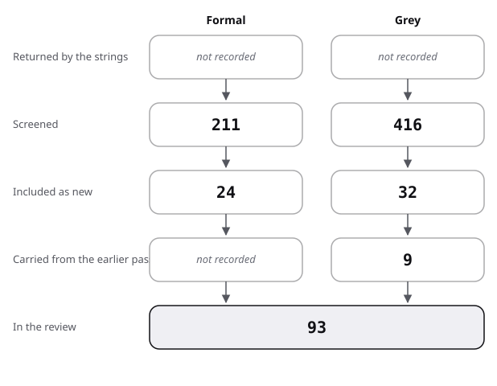

# Sources: the pool of the multivocal review, with its flow and quality scores

This file lists how many records each search found, screened and added. It then lists every source in the review, with its kind, how it was found, its quality and where it is used. The method of the search is in [protocol](protocol.md), and the full citations of the sources are in the bibliography.

## Flow: summary

| Stage | Formal | Grey |
|---|---|---|
| Returned by the strings | not recorded | not recorded |
| Screened | 211 | 416 |
| Included as new | 24 | 32 |
| Carried from the earlier pass | not recorded | 9 |
| In the review | 52 | 41 |

- Formal:
  - The engine's hit counts are given per string below, with no total.
  - Screened is the 211 titles read for the strings F1 to A2.
  - Snowballing and lookups screened further records (558 forward, 45 backward, 18 for the web queries W1 and W2, 9 for the title lookups, 5 for O1).
  - Included is 24 sources: 16 reviews and 8 studies.
  - The earlier pass is recorded only as a pool of 36 sources before this search, with no split by kind.
- Grey:
  - The web queries returned about 10 results each, with no total.
  - Screened is 105 web results (10 read in full) and 311 Q/A records, which were returned and screened alike.
  - Included as new is 11 from the web search and 21 Q/A threads.
  - The earlier pass held 9 grey sources.

In the review: the architecture descriptions source rows of each kind, counted by script. The 52 formal rows include the method paper Garousi 2019, which the totals at the end of this file count apart.

The figure draws the stages of the table for architecture descriptions.

## Flow: formal strings

Hit counts are the engine's on 2026-10-28. That engine is the Semantic Scholar bulk search, or arXiv for A1 and A2. The "Screened" column counts titles read, in order of citations. The "Added" column is the number of new sources that entered the pool.

| String | Hits | Screened | Relevant | Added |
|---|---|---|---|---|
| F1 | 703 | 12 | 4 | 0 |
| F2 | 340 | 10 | 2 | 0 |
| F3 | 620 | 8 | 3 | 0 |
| F4 | 553 | 8 | 3 | 1 |
| F5 | 853 | 14 | 0 | 0 |
| F5b | 55 | 10 | 0 | 0 |
| F6 | 65 | 25 | 12 | 7 |
| F7 | 7 | 7 | 2 | 0 |
| F8 | 212 | 14 | 0 | 0 |
| F9 | 10 | 10 | 0 | 0 |
| F10 | 466 | 14 | 3 | 0 |
| F11 | 152 | 14 | 1 | 0 |
| F12 | 14 | 12 | 3 | 2 |
| F13 | 20 | 12 | 3 | 0 |
| F14 | 191 | 12 | 3 | 0 |
| F15 | 0 | 0 | 0 | 0 |
| A1 | 18 | 18 | 5 | 2 |
| A2 | 11 | 11 | 5 | 0 |
| Total | | 211 | | 12 |

F5, F5b and F8 are the strings whose hits were mostly unrelated work; F15 found no study of ARCHITECTURE.md.

## Flow: snowballing and lookups

| Step | Seeds | Records screened | Added |
|---|---|---|---|
| Forward | Rost 2013 (32 citing), Ernst 2023 (16), Dagenais 2010 (175), Lethbridge 2003 (200 of more), Ding 2014a (118), de Graaf 2016 (17) | 558 | 4 |
| Backward | Ernst 2023 (45 references) | 45 | 2 |
| Web queries W1, W2 | existing reviews | 18 | 3 |
| Title lookups | nine lookups to read abstracts | 9 | 3 |
| OpenAlex test query O1 | the Helsinki thesis | 5 | 1 |

- Forward snowballing added Rost 2016, Soliman 2025, Ribeiro 2026 and Manai 2019.
- Backward snowballing added Heijstek 2011 and Schoonewille 2011; Capilla 2016 also appeared, already added under F4.
- Lookups added de Dieu 2024, Santos 2025 and Wan 2023.
- W1 added Viglioni 2024, Zhi 2015 and Islam 2023; O1 added Theunissen 2022.

## Flow: grey queries

| Query | Screened | Read in full | Included |
|---|---|---|---|
| G1 | 9 | 0 | 0 |
| G2 | 9 | 1 | 1 |
| G3 | 10 | 1 | 1 |
| G4 | 10 | 2 | 2 |
| G5 | 9 | 0 | 0 |
| G6 | 10 | 2 | 2 |
| G7 | 10 | 1 | 0 |
| G8 | 9 | 0 | 0 |
| G9 | 10 | 1 | 1 |
| G10 | 10 | 1 | 1 |
| G11 | 9 | 1 | 1 |
| Total | 105 | 10 | 9 |

Two more grey sources, Harhio 2022 and Manai 2019, came through the existing-review search; the review holds 20 scored grey sources from the web search, 9 from before the search and 11 added.

Q/A sites were searched separately on 2026-10-28 (strings AD1 to AD15, [protocol](protocol.md) section 5).

- 311 records were returned and screened, with repeats across strings.
- 21 threads were included: 20 first met in an AD string and 1 in a system-diagrams string.
- They are scored with the grey sources below, tier 2.
- The review now holds 41 scored grey sources.

## Excluded, by reason (named cases only)

| Reason | Cases |
|---|---|
| E1 notation and description languages | pi-ADL, a systems-of-systems 42010 application, a position paper on description languages (3) |
| E2 decision records | a design-decision recovery paper, a traceability mapping, a quality-attribute decision review (3) |
| E3 enterprise architecture documentation | four papers (4) |
| E4 marketing | an incident-management vendor page (1) |
| E5 untraceable figure | a survey share of 12% for accurate design documents (1) |
| E6 could not be read | three SEI technical reports, one textbook, the Q/A site pages as the web engine returned them (5); the sites were then read through their API, see protocol section 5 |
| E7 documentation in general | Diátaxis, an API-documentation paper, a popularity study (3) |
| E8 tools without reader evaluation | six papers on generating or recovering documentation |
| E9 reviews of other architecture topics | evolution, evaluation, analysis, text analysis, systems of systems (5) |

## Pool and quality

Kind: formal, or grey with its tier. Quality: for formal sources the evidence grade; for grey sources the score out of 20 as A (max 4) M (6) O (4) D (1) P (1) N (2) I (1) T (1). Sources below 10 are examples of practice only.

### Grey sources, scored

| Key | Kind | Found via | Quality | Used in |
|---|---|---|---|---|
| ISO 2022 | grey tier 1 | prior | A4 M4 O2.5 D1 P1 N1.5 I1 T1 = 16 | review 2, frame |
| Clements 2010 | grey tier 1 | prior | A4 M4 O1.5 D1 P1 N2 I1 T1 = 15.5 | review 2, baseline |
| Rozanski 2011 | grey tier 1 | prior | A4 M3.5 O1.5 D1 P1 N1.5 I1 T1 = 14.5 | review 2, baseline |
| matklad 2021 | grey tier 3 | prior | A3.5 M4 O2 D1 P0.5 N1.5 I1 T0 = 13.5 | review 6, baseline |
| Harhio 2022 | grey tier 1 | given | A2 M3.5 O2.5 D1 P0.5 N1 I0 T1 = 11.5 (abstract only) | review 0 |
| Penchikala 2009 | grey tier 2 | G9 | A3.5 M3 O1 D1 P0.5 N1 I0.5 T0.5 = 11 | review 6 |
| Rust 2026c | grey tier 2 | G3 | A2.5 M4.5 O2 D0 P0.5 N0.5 I0.5 T0.5 = 11 | review 6 |
| Brown 2026a | grey tier 2 | prior | A3 M3 O1.5 D0 P0.5 N1 I1 T0.5 = 10.5 | frame, review 6 |
| Thoughtworks 2020 | grey tier 2 | prior | A3.5 M2 O1.5 D1 P0.5 N0.5 I1 T0.5 = 10.5 | review 6 |
| IcePanel 2025 | grey tier 2 | prior | A2 M3.5 O1.5 D1 P0.5 N1 I0.5 T0.5 = 10.5 | review 6, against |
| Manai 2019 | grey tier 1 | fwd Lethbridge 2003 | A1.5 M4 O2.5 D1 P0 N0.5 I0 T1 = 10.5 (abstract only) | review 3 |
| Brown 2018 | grey tier 2 | G6 | A3 M3 O1.5 D1 P0.5 N0.5 I0.5 T0.5 = 10.5 | review 6 |
| docToolchain 2026 | grey tier 2 | G4 | A3 M3 O1.5 D0.5 P0.5 N1 I0.5 T0.5 = 10.5 | review 6 |
| Knauf 2022 | grey tier 3 | G4 | A1.5 M5 O2 D1 P0.5 N0.5 I0 T0 = 10.5 | review 6 |
| Starke 2026b | grey tier 2 | G10 | A3 M3.5 O1.5 D0 P0.5 N0.5 I0.5 T0.5 = 10 | review 6 |
| Starke 2026 | grey tier 2 | prior | A3 M3 O0.5 D0 P0.5 N1 I1 T0.5 = 9.5, below 10 | review 6, baseline |
| IcePanel 2024 | grey tier 2 | G11 | A2 M2.5 O1.5 D1 P0 N1 I0.5 T0.5 = 9, below 10 | review 6 |
| Brown 2026c | grey tier 2 | G6 | A3 M3 O1 D0 P0.5 N0.5 I0.5 T0.5 = 9, below 10 | review 6 |
| Backstage 2020 | grey tier 3 | prior | A2.5 M2.5 O0.5 D1 P0 N1 I1 T0 = 8.5, below 10 | review 6 |
| Gliffy 2023 | grey tier 3 | G2 | A0.5 M2 O1 D1 P0 N0 I0 T0 = 4.5, below 10 | review 6 |
| SESE 2017a | grey tier 2 | AD7 | A2.5 M4 O4 D1 P0.5 N1.5 I0.5 T0.5 = 14.5 | review 6, against |
| SESE 2010a | grey tier 2 | AD7 | A1.5 M3 O4 D1 P0.5 N2 I0.5 T0.5 = 13 | position |
| SESE 2017b | grey tier 2 | AD7 | A1 M3.5 O3.5 D1 P0.5 N0.5 I0.5 T0.5 = 11 | review 6 |
| SESE 2010b | grey tier 2 | AD7 | A1.5 M5 O4 D1 P0.5 N1.5 I0 T0.5 = 14 | against |
| SESE 2013a | grey tier 2 | AD7 | A3 M5 O4 D1 P0.5 N1.5 I0 T0.5 = 15.5 | review 6 |
| SESE 2012a | grey tier 2 | AD7 | A2 M4 O4 D1 P0.5 N1.5 I0.5 T0.5 = 14 | review 6 |
| SESE 2014a | grey tier 2 | AD13 | A2.5 M4 O4 D1 P1 N2 I1 T0.5 = 16 | review 6 |
| SESE 2015a | grey tier 2 | AD1 | A2 M4.5 O4 D1 P0.5 N2 I0.5 T0.5 = 15 | review 6 |
| SESE 2010c | grey tier 2 | AD1 | A1 M4.5 O3.5 D1 P0 N1 I0.5 T0.5 = 12 | sources only |
| SESE 2011a | grey tier 2 | AD15 | A1.5 M4 O3.5 D1 P0.5 N2 I0.5 T0.5 = 13.5 | against |
| SESE 2014b | grey tier 2 | SD6 (other topic's string) | A1.5 M4 O4 D1 P0 N2 I0.5 T0.5 = 13.5 | against |
| SESE 2017c | grey tier 2 | AD1 | A2 M4.5 O4 D1 P1 N1.5 I0 T0.5 = 14.5 | against |
| SESE 2011b | grey tier 2 | AD6 | A0.5 M2.5 O4 D1 P0 N1 I0 T0.5 = 9.5, below 10 | review 6 (example only) |
| SESE 2012b | grey tier 2 | AD1 | A0.5 M5 O4 D1 P0 N1 I0.5 T0.5 = 12.5 | position |
| SESE 2019a | grey tier 2 | AD7 | A2 M5 O3.5 D1 P0 N1 I0 T0.5 = 13 | position |
| SO 2014a | grey tier 2 | AD4 | A1 M3.5 O3.5 D1 P0 N1.5 I0 T0.5 = 11 | against |
| SO 2014b | grey tier 2 | AD4 | A1.5 M3 O2.5 D1 P0 N1.5 I0 T0.5 = 10 | against |
| SO 2021a | grey tier 2 | AD5 | A1.5 M4.5 O4 D1 P1 N2 I0.5 T0.5 = 15 | against |
| SO 2018a | grey tier 2 | AD7 | A1.5 M4 O3 D1 P1 N1.5 I0.5 T0.5 = 13 | review 6 |
| SO 2011a | grey tier 2 | AD6 | A1 M2 O2.5 D1 P0 N0.5 I0.5 T0.5 = 8, below 10 | sources only (example only) |
| SO 2008a | grey tier 2 | AD7 | A1 M4 O2.5 D1 P0 N0.5 I0 T0.5 = 9.5, below 10 | sources only (example only) |

Eight of the 41 grey sources fall below 10 and stay only as examples of practice.

- Five come from the web search: Starke 2026 (the arc42 site), Backstage 2020, IcePanel 2024, Brown 2026c (the C4 FAQ) and Gliffy 2023.
- Three are Q/A threads: SESE 2011b, SO 2011a and SO 2008a.
- The shift from 67% to 81% in context-diagram use rests on IcePanel 2025, which passes.

### Formal sources: reviews (strand 0)

| Key | Kind | Found via | Quality | Used in |
|---|---|---|---|---|
| Ding 2014a | formal, systematic review | prior | supported with caveat (abstract) | review 0 |
| Steinmacher 2015 | formal, systematic review | prior | supported with caveat (full text read) | review 0 |
| Weinreich 2016 | formal, systematic review | F6 | supported with caveat (abstract summary) | review 0 |
| Li 2013 | formal, mapping study | F6 | not graded, title only | review 0 |
| Júnior 2019 | formal, mapping study | F6 | not graded, title only | review 0 |
| Guessi 2012 | formal, systematic review | F6 | not graded, title only | review 0 |
| Guessi 2015 | formal, systematic review | F6 | not graded, title only | review 0 |
| Viglioni 2024 | formal, mapping study | W1 | supported with caveat (search summary) | review 0 |
| de Dieu 2024 | formal, mapping study | title lookup | supported with caveat (abstract) | review 0 |
| Soliman 2025 | formal, mapping study | fwd de Graaf 2016 | not graded, title only | review 0 |
| Theunissen 2022 | formal, mapping study | O1 | supported with caveat (abstract) | review 0 |
| Zhi 2015 | formal, mapping study | W1 | supported with caveat (full text read) | review 0 |
| Islam 2023 | formal, systematic review | W1 | supported with caveat (abstract) | review 0 |
| Santos 2025 | formal, systematic review | title lookup | supported with caveat (abstract) | review 0 |
| Ribeiro 2026 | formal, multivocal review | fwd Dagenais 2010 | not graded, title only | review 0 |
| Capilla 2016 | formal, retrospective | F4, back Ernst 2023 | not graded, title only | review 0 |
| Farenhorst 2009 | formal, state of the art | F6 | not graded, title only | review 0 |
| Nakagawa 2010 | formal, mapping study | F6 | not graded, title only | review 0 |
| Garousi 2019 | formal, method guidelines | prior | convention | protocol |

### Formal sources: studies

| Key | Kind | Found via | Quality | Used in |
|---|---|---|---|---|
| Perry 1992 | formal | prior | convention | frame, review 2 |
| Soni 1995 | formal | prior | supported with caveat (secondary) | review 2 |
| Kruchten 1995 | formal | prior | convention | review 2, baseline |
| Emery 2009 | formal | prior, F2 | convention | review 2 |
| Malavolta 2013 | formal | prior | measured, descriptive (secondary) | review 1 |
| Aghajani 2019 | formal | prior | measured, descriptive (secondary) | review 1 |
| Aghajani 2020 | formal | prior | measured, descriptive (secondary) | review 1 |
| Lethbridge 2003 | formal | prior | supported with caveat | review 3 |
| Rost 2013 | formal | prior | measured, descriptive | review 3 |
| Dagenais 2010 | formal | prior | supported with caveat (secondary) | review 3 |
| de Dieu 2022 | formal | prior | measured, descriptive (secondary) | review 3 |
| Rukmono 2026 | formal | prior | supported with caveat | review 3 |
| Lima Neto 2015 | formal, preprint | A1, fwd Rost 2013 | measured, descriptive (same survey as Rost 2013) | review 3 |
| Wan 2023 | formal | title lookup | measured, descriptive (abstract) | review 3 |
| Ernst 2023 | formal | prior | measured, one study | review 4 |
| de Graaf 2016 | formal | prior | supported with caveat (secondary) | review 4 |
| Kazman 2016 | formal | prior | supported with caveat (secondary) | review 4 |
| Arisholm 2006 | formal | prior | measured (secondary) | review 4 |
| Dzidek 2008 | formal | prior | measured (secondary) | review 4 |
| Robillard 2016 | formal | prior | supported with caveat (secondary) | review 4 |
| Heijstek 2011 | formal | back Ernst 2023 | measured (search summary, secondary) | review 4 |
| Schoonewille 2011 | formal | back Ernst 2023 | supported with caveat (search summary, secondary) | review 4 |
| Rost 2016 | formal | fwd Rost 2013 | convention, with a later validation (secondary) | review 4, against |
| Ding 2014b | formal | prior | measured, descriptive (secondary) | review 5 |
| Muszynski 2022 | formal | prior | measured, descriptive (secondary) | review 5 |
| Migliorini 2024 | formal | prior | measured, descriptive | review 5 |
| Jongeling 2025 | formal | prior | supported with caveat (abstract only) | review 6 |
| Chatlatanagulchai 2026 | formal, preprint | prior | measured, descriptive | review 6 |
| Zarzycki 2026 | formal, preprint | prior | measured, descriptive | review 6 |
| Gloaguen 2026 | formal, preprint | prior | measured, two settings | review 6 |
| De Luca 2026 | formal | F12, A1 | supported with caveat (abstract; 22 developers) | review 6 |
| Larsen 2026 | formal | F12, A1 | convention (abstract; 6 practitioners) | review 6 |
| Elberzhager 2026 | formal, preprint | A1, A2 | supported with caveat (abstract) | review 6 |

### Totals

- Pool: 92 sources in the review (36 before this search, 35 added, 21 Q/A threads added), plus the method paper Garousi 2019 in the protocol.
- Grey: 41 scored (20 from the web search, 21 Q/A threads), 8 below 10. Formal and preprint: 51 in the review.
- Added: 24 formal (16 reviews, 8 studies) and 11 grey from the web search, then 21 grey Q/A threads.
- The Q/A threads mostly repeat the pool (4+1 views, IEEE 1471, C4, arc42, stale documents, the panel advice of Penchikala 2009). SESE 2010c is cited only in the table above. No thread reports a measurement or a test with readers.
