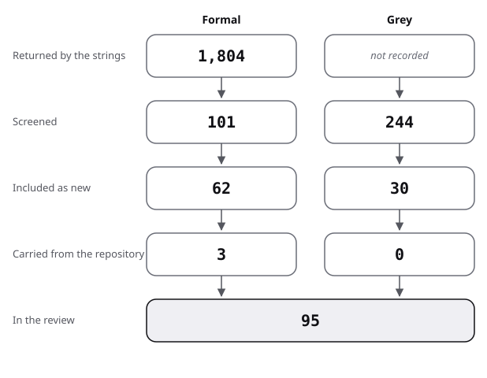

# Sources: the pool, the flow and the scores

This is the pool of the architecture-design review: how screening narrowed it, then one row per source (kind, route found, quality, use). Method and strings are in [protocol](protocol.md); terms are in [frame](frame.md).

## Flow

| Stage | Formal | Grey |
|---|---|---|
| Returned by the strings | 1,804 (Semantic Scholar only) | not recorded |
| Screened | 101 | 244 |
| Included as new | 62 | 30 |
| Carried from the repository | 3 | 0 |
| In the review | 65 | 30 |

- Formal:
  - 1,804 records were returned by 31 strings (Semantic Scholar); arXiv counts were not obtained (HTTP 429).
  - 101 titles were screened (the top hits of strings R1 to R17); strings F1 to F14 gave counts only.
  - 62 works were included as new, found through leads, reviews and title lookups. Among them are 13 added in the second pass (socio-technical congruence, hotspots and architectural roots, architects' reasoning, Shaw and Garlan, Accelerate).
  - 3 were carried from earlier reviews of this repository (Garousi 2019, Tofan 2014, Gloaguen 2026).
  - Excluded after reading a title: hits on robotics, digital twins, cyber-physical systems, security and sustainability architectures, not counted; 5 more relevant works located and not read (three microservice migration studies; two tactics reviews).
- Grey:
  - 244 Q/A records were screened by title; web results were about 10 per search over 7 searches and 19 pages read directly, not counted per string.
  - 30 were included as new: 11 Q/A threads, 13 web sources scored, and 6 books listed but not opened.
  - Excluded: Prime Video's page (moved; read only in secondary write-ups), 233 Q/A records, 5 pages not read.
- Added by snowballing: none.
- Existing reviews found: 14, listed in review.md strand 0.

The figure draws the stages of the table for architecture design.

## Formal sources

"narrative" means carried from an earlier review of this repository. Quality words follow the README grades.

- "Abstract read": the abstract was read in full from the publisher, a repository or a preprint.
- "In a search summary" or "in a listing": it was read in another source's account (secondary).
- "Summary line": a one-sentence summary only.
- "Located only": no result is claimed beyond the title.

| Key | Kind | Found via | Quality | Used in |
|---|---|---|---|---|
| Garousi 2019 | formal | narrative (earlier pass) | method paper | protocol |
| Tofan 2014 | formal | earlier pass; R1 | systematic mapping; linked, full text read in design-decisions | review 0 |
| Gloaguen 2026 | formal | earlier pass | preprint; linked only | review 11 |
| Hofmeister 2007 | formal | lead | comparison of five industrial methods; full text read through a library | review 1 |
| Falessi 2011 | formal | lead (found by title) | survey of decision-making techniques; abstract read in a search summary (secondary) | review 0, 1 |
| Shaw 1996 | formal | lead (restored) | book, not opened; library record and table of contents read | review 3 |
| Parnas 1972 | formal | lead | argument from one worked example; abstract read in a search summary (secondary); full text not reached | review 2 |
| Stevens 1974 | formal | lead | argument; located only, abstract not reached (publisher gives none) | review 2 |
| Baldwin 2000 | formal | lead | book, not opened | review 2, 6 |
| MacCormack 2006 | formal | lead | empirical, two products; abstract read | review 2 |
| MacCormack 2012 | formal | lead | empirical test of mirroring; abstract partly read | review 6 |
| Colfer 2016 | formal | lead | review of 142 studies; abstract read | review 6 |
| Cataldo 2008 | formal | lead | empirical framework; summary line read (secondary); abstract not reached | review 6 |
| Cataldo 2013 | formal | lead | empirical, two large projects; abstract read in a search summary (secondary) | review 6 |
| Mauerer 2022 | formal | found by search summary | measured, 25 open source projects; abstract read | review 6 |
| Herbsleb 1999 | formal | lead (found by title) | case study; abstract read in a search summary (secondary) | review 6 |
| Nagappan 2008 | formal | lead (found by title) | measured, one company; abstract read | review 6 |
| Basili 1996b | formal | found by title | measured, 8 projects; abstract read | review 2 |
| Briand 2000 | formal | found by title | measured; abstract read in a summary, numbers (secondary) | review 2 |
| Xiao 2014 | formal | lead (Mo, Cai, Kazman) | measured, three open source projects; abstract read | review 2, 7 |
| Mo 2015 | formal | lead (Mo, Cai, Kazman) | measured, nine open source projects and one commercial; abstract read in a search summary (secondary) | review 2, 7 |
| Mo 2016 | formal | lead (Mo, Cai, Kazman) | measured, 108 open source and 21 industrial projects; abstract read in a search summary (secondary) | review 2, 7 |
| Kazman 2015 | formal | lead (Kazman) | industrial case study; abstract read in a search summary, no numbers (secondary) | review 7 |
| Nayebi 2019 | formal | found by search summary | longitudinal industrial case; abstract read | review 7 |
| Prechelt 2001 | formal | found by search summary | controlled experiment, professionals, nine tasks; abstract read on the group's page | review 3; against |
| Prechelt 2002 | formal | lead | two controlled experiments; draft abstract, secondary | review 3 |
| Zhang 2012 | formal | lead | systematic mapping; abstract read | review 0, 3 |
| Khomh 2008 | formal | F12 neighbourhood | empirical; abstract of the technical report version read in a search summary (secondary) | review 3; against |
| Vokac 2004 | formal | F12 neighbourhood | industrial case, 500,000 lines over three years; abstract read in a record (secondary) | review 3; against |
| Ameller 2013 | formal | found by title | interviews; located only, abstract not reached | review 4 |
| Bellomo 2015 | formal | found by title | descriptive, ATAM data; secondary | review 4 |
| Kazman 2000 | formal | lead | technical report; located only, copy refused | review 4 |
| Babar 2004 | formal | R6 | comparison of four methods; abstract read | review 0, 4 |
| Dobrica 2002 | formal | found by title | survey of eight methods; summary line read (secondary) | review 0, 4 |
| Abrahamsson 2010 | formal | lead | position; introduction read in a search summary, abstract not reached in full | review 5 |
| Waterman 2015 | formal | lead | grounded theory, 44 participants; abstract read in a listing | review 5 |
| Boehm 2008 | formal | found by title | measured, 161 projects; abstract read | review 5 |
| Li 2022 | formal | R4 | systematic mapping, 73 studies; abstract read | review 0, 7 |
| de Silva 2012 | formal | lead | survey; abstract read in a search summary (secondary) | review 0, 7 |
| Le 2018 | formal | R5 | empirical; located only, opening of the abstract read | review 7 |
| Besker 2018 | formal | R3; lead | systematic review; abstract read in a search summary, no count (secondary) | review 0, 7 |
| Verdecchia 2021 | formal | lead | grounded theory and focus groups; abstract read | review 7 |
| Ernst 2015 | formal | found by title | survey, 1,831 participants; secondary | review 7 |
| Mumtaz 2021 | formal | R5 | systematic mapping; abstract read | review 0, 7 |
| Baabad 2020 | formal | R4 | systematic review; located only, abstract not reached | review 0, 7 |
| Taibi 2017 | formal | found by title | interviews; secondary | review 8 |
| Di Francesco 2018 | formal | found by title | industrial survey; located only, abstract not reached | review 8 |
| Blinowski 2022 | formal | found by title | measured, controlled experiments; abstract read | review 8 |
| Mendonca 2021 | formal | G1 | company report in a peer-reviewed magazine; abstract read | review 8 |
| Ghemawat 2023 | formal | found by title | prototype and position; abstract read | review 8 |
| Su 2024 | formal | R9 | multivocal review; abstract read | review 0, 8 |
| Vera-Rivera 2021 | formal | R9 | systematic review, 29 of 326 papers; abstract read | review 0, 8 |
| Tang 2010 | formal | lead (Tang) | experiment on design effectiveness; summary line read (secondary); abstract not reached | review 12 |
| Tang 2012 | formal | lead (Tang) | observation of two design teams; abstract read in a search summary (secondary) | review 12 |
| Tang 2015 | formal | lead (Tang) | experiment on design decisions; summary line read (secondary); abstract not reached | review 12 |
| Razavian 2016 | formal | lead | multiple case studies, 12 student groups; abstract read through a library | review 12 |
| Mohanani 2020 | formal | lead | systematic mapping, 65 articles; preprint abstract read | review 0, 12 |
| Zannier 2007 | formal | lead | interviews with designers; summary line read (secondary); abstract not reached | review 12 |
| Forsgren 2018 | formal | lead (restored) | book, not opened; publisher page read | review 6 |
| Esposito 2025 | formal | R8; R12 | multivocal review; abstract read | review 0, 11 |
| Schmid 2025 | formal | R12 | systematic review, 18 articles; abstract read | review 0, 11 |
| Dhar 2024 | formal | F14 | exploratory study; abstract read | review 11 |
| Li 2024 | formal | F14 | benchmark case study; abstract read | review 11 |
| Hong 2023 | formal | F14 | framework; abstract read | review 11 |
| Su 2026 | formal | R12; F14 | mining of 980 decision records; abstract partly read | review 11 |

## Grey sources, scored

The eight subtotals appear as authority, methodology, objectivity, date, position, novelty, impact and outlet, as in the [method](../README.md#method) note. Under 10 of 20, a source is an example of practice only.

| Key | Kind | Found via | Quality (total, then subtotals) | Used in |
|---|---|---|---|---|
| Conway 1968 | grey tier 1 | P | 15.5 of 20 (4 / 2 / 3.5 / 1 / 1 / 2 / 1 / 1) | review 6 |
| Lewis 2014 | grey tier 3 | P | 14 of 20 (4 / 2.5 / 3 / 1 / 0.5 / 2 / 1 / 0) | review 8, 9 |
| Fowler 2015 | grey tier 3 | P | 10.5 of 20 (3.5 / 1.5 / 2.5 / 1 / 0.5 / 1 / 0.5 / 0) | review 8, 9 |
| Noonan 2018 | grey tier 3 | G1 | 12.5 of 20 (3 / 3.5 / 2 / 1 / 0.5 / 1.5 / 1 / 0) | review 8, 9 |
| Müller 2020 | grey tier 3 | P | 12.5 of 20 (3 / 3 / 2.5 / 1 / 0.5 / 1.5 / 1 / 0) | review 2, 9 |
| Loukides 2020 | grey tier 1 | G4 | 14 of 20 (3 / 4 / 2.5 / 1 / 0.5 / 1 / 1 / 1) | review 8, 9 |
| DORA 2025 | grey tier 2 | P | 14.5 of 20 (4 / 3 / 3 / 1 / 1 / 1 / 1 / 0.5) | review 6, 9 |
| ThoughtWorks 2014 | grey tier 1 | P | 10.5 of 20 (3 / 1.5 / 2 / 1 / 0.5 / 1 / 0.5 / 1) | review 6, 9 |
| ThoughtWorks 2017 | grey tier 1 | G2 | 10.5 of 20 (3 / 1.5 / 2 / 1 / 0.5 / 1 / 0.5 / 1) | review 9 |
| Microsoft 2025 | grey tier 1 | P | 12.5 of 20 (3.5 / 2.5 / 2 / 1 / 0.5 / 1 / 1 / 1) | review 3, 9 |
| AWS 2026d | grey tier 1 | P | 10.5 of 20 (3.5 / 2 / 2 / 0 / 0.5 / 0.5 / 1 / 1); a blind second rater gave 9.5, so an example of practice only | review 4, 9 |
| ISO 2023 | grey tier 1 | G6 | 14 of 20 (3.5 / 2 / 3.5 / 1 / 1 / 1 / 1 / 1) | review 4, 9 |
| Team Topologies 2026 | grey tier 2 | P | 8.5 of 20 (3 / 1 / 1.5 / 0 / 0.5 / 1 / 1 / 0.5) | review 6, 9 |

Below the threshold: Team Topologies 2026 (example of practice only).
Books, not opened, not scored (named, no claim rests on them): Cervantes 2016, Bass 2021, Evans 2003, Ford 2017, Skelton 2025, Ousterhout 2021.

## Grey sources from Q/A sites

These threads are grey tier 2, with the date read 2026-10-29. The subtotals are as above, and the rules are in the [shared protocol](../architecture-descriptions/protocol.md#q-a-sites). The votes, views and answers per thread, as read on 2026-10-29, are in [bibliography](../bibliography.md).

| Key | Kind | Found via | Quality (total, then subtotals) | Used in |
|---|---|---|---|---|
| SESE 2014d | grey tier 2 | AR1 | 12 of 20 (1 / 3.5 / 3.5 / 1 / 0.5 / 1.5 / 0.5 / 0.5) | review 10 |
| SESE 2017h | grey tier 2 | AR7 | 17 of 20 (3 / 4.5 / 4 / 1 / 1 / 2 / 1 / 0.5) | review 8, 10 |
| SESE 2018d | grey tier 2 | AR7 | 15 of 20 (2.5 / 4 / 4 / 1 / 0.5 / 1.5 / 1 / 0.5) | review 8, 10 |
| SESE 2020b | grey tier 2 | AR7 | 14.5 of 20 (2.5 / 4 / 4 / 1 / 0.5 / 1.5 / 0.5 / 0.5) | review 8, 10 |
| SESE 2020c | grey tier 2 | AR8 | 12.5 of 20 (2.5 / 3 / 3.5 / 1 / 0.5 / 1.5 / 0 / 0.5) | review 8, 10 |
| SESE 2025a | grey tier 2 | AR2 | 11.5 of 20 (1.5 / 3.5 / 3.5 / 1 / 0 / 1.5 / 0 / 0.5) | review 8, 10 |
| SESE 2012k | grey tier 2 | AR9 | 12.5 of 20 (1.5 / 3 / 4 / 1 / 0.5 / 1 / 1 / 0.5) | review 2, 10 |
| SESE 2020d | grey tier 2 | AR9 | 14 of 20 (2 / 4 / 4 / 1 / 0.5 / 1.5 / 0.5 / 0.5) | review 2, 10 |
| SESE 2022b | grey tier 2 | AR15 | 14.5 of 20 (2.5 / 4 / 4 / 1 / 0.5 / 1 / 1 / 0.5) | review 10 |
| SESE 2011k | grey tier 2 | AR5 | 11 of 20 (1.5 / 3 / 3.5 / 1 / 0 / 1 / 0.5 / 0.5) | review 2, 10 |
| SO 2010c | grey tier 2 | AR4 | 9 of 20 (2 / 1.5 / 3 / 1 / 0 / 1 / 0 / 0.5) | review 10 |

Below the threshold: SO 2010c (example of practice only).

## Adoption counts, descriptive, read 2026-10-29

Public repository pages, read without identity; stars measure interest, not use.

| Count | Value | Caveat |
|---|---|---|
| stars: ArchUnit (a Java library to assert architecture rules) | 3,882 | created 2017-04 |
| stars: Spring Modulith (modular applications with Spring Boot) | 1,206 | created 2022-07 |
| stars: Packwerk (Shopify's boundary checker, Müller 2020) | 1,928 | created 2020-09 |
| stars: modular-monolith-with-ddd (a sample) | 14,101 | a worked example, last push 2024-06 |
| stars: awesome-software-architecture (a list) | 11,748 | a reading list |
| repositories with topic software-architecture | 4,221 | self-tagged |
| respondents using microservices (Loukides 2020) | 77% of 1,502 | mailing-list sample |
