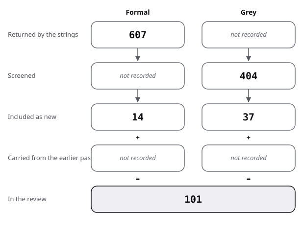

# Sources: the pool and its flow

This file lists every search run, how many results were found, screened and included, and one row for each source in the pool, with its quality.

Method: [protocol](protocol.md). Searches ran on 2026-10-28. Strings are quoted as run.

## Formal search

| Id | Engine | String | Found | Screened | Included |
|---|---|---|---|---|---|
| F1 | OpenAlex | `"pseudocode" AND ("systematic review" OR "mapping study" OR "literature review")` | 35 | 8 | 1 |
| F2 | OpenAlex | `pseudocode AND comprehension` | 50 | 8 | 2 |
| F3 | OpenAlex | `flowchart AND (pseudocode OR "program comprehension")` | 232 | 8 | 0 |
| F4 | arXiv API | `abs:pseudocode` | 236 | 3 | 0 |
| F5 | arXiv API | `abs:pseudocode AND abs:comprehension` | 10 | 3 | 0 |
| F6 | arXiv API | `abs:pseudocode AND (abs:"systematic review" OR abs:"literature review" OR abs:"mapping study")` | 1 | 1 | 0 |
| F7 | arXiv API | `abs:pseudocode AND abs:reproducibility` | 13 | 3 | 0 |
| F8 | arXiv API | `abs:"pseudocode" AND abs:"flowchart"` | 3 | 3 | 0 |
| F9 | arXiv API | `abs:"literate programming"` | 27 | 3 | 0 |
| R1 | web search | systematic literature review pseudocode comprehension notation | 9 | 9 | 1 |
| R2 | web search | flowchart versus pseudocode programming education systematic review | 8 | 8 | 2 |
| R3 | web search | pseudocode to code generation survey systematic literature review | 9 | 9 | 3 |
| R4 | web search | "pseudocode" novice programmers literature review computing education research | 8 | 8 | 0 |
| R5 | web search | systematic review visual versus textual programming notation comprehension block-based text-based | 10 | 10 | 1 |
| R6 | web search | reproducibility pseudocode ambiguity algorithm descriptions papers empirical study reimplementation | 9 | 9 | 0 |
| R7 | web search | `Ince Hatton Graham-Cumming "The case for open computer programs" Nature 2012` | 10 | 10 | 1 |
| R8 | web search | algorithm presentation pseudocode conventions Knuth Sedgewick Cormen style comparison | 10 | 10 | 0 |

- OpenAlex stopped answering after F3 (a shared daily budget was spent); F4 to F9 are arXiv counts, which cover abstracts only and are not comparable with F1 to F3.
- F1 to F3 screened the first eight records in relevance order; the other records were not read.

Snowballing (Semantic Scholar graph API):

| Direction | From | Retrieved | Included |
|---|---|---|---|
| forward | Shneiderman 1977 | 60 (cap) | Coffman 2026, Cabo 2018 |
| forward | Ramsey 1983 | 51 | McConnell 2004 (as grey) |
| forward | Scanlan 1989 | 60 (cap) | Andrzejewska 2020 |
| forward | Wyrich 2023 | 49 | Neumüller 2025 |
| forward | Andrzejewska 2022 | 3 | 0 |
| forward | Ulate-Caballero 2021 | 0 | 0 |
| backward | Andrzejewska 2022 | 40 | 0 |
| backward | Wyrich 2023 | 100 (cap) | 0 |

Flow summary:

| Stage | Formal | Grey |
|---|---|---|
| Returned by the strings | 607 | not recorded |
| Screened | not recorded | 404 |
| Included as new | 14 | 37 |
| Carried from the earlier pass | not recorded | not recorded |
| In the review | 54 | 47 |

- Formal:
  - 17 strings were run.
  - The hits reported are 607 (F1 to F9), split below.
  - Screened is recorded in parts only: 24 OpenAlex records, 16 arXiv records, 73 web results and 363 snowball titles.
  - 14 sources were included as new.
- Grey:
  - 12 web strings and 8 Q/A strings (PS1 to PS8) were run.
  - The web results returned are not recorded; the Q/A strings returned and screened 241.
  - Screened is 404 (163 web, 241 Q/A).
  - 37 were included as new (11 web, 26 Q/A threads).
  - The file does not give the size of the earlier pass.

In the review: the pseudocode source rows of each kind, counted by script. The 54 formal rows include the method paper Garousi 2019.

The figure draws the stages of the table for pseudocode.

- Hits reported: 317 (OpenAlex F1 to F3) and 290 (arXiv F4 to F9).
- Ulate-Caballero 2021 was found by both F1 and R1 and is counted once in the included total.

Excluded or not followed, by reason:

- Not read, for want of access or time:
  - A dissertation by Wallace (1986), with restricted access.
  - A paper by Ackermann (1989), which has no abstract.
  - Two papers by Wright and Reid (1973, 1975), found by backward snowballing.
  - An eye-tracking survey by Obaidellah and a CS1 review by Luxton-Reilly, both of 2018.
  - Two reimplementation case studies of 2023, by Zemmels and by Lukats.
- Off topic: general code-generation surveys that do not treat pseudocode as an input.
- Unreadable: IB "Pseudocode in Examinations" (the only copy found returned 404), a TU Delft note (connection refused).

## Grey search

| Id | String | Screened | Included |
|---|---|---|---|
| G1 | pseudocode style guide how to write pseudocode for algorithms in papers | 18 | 2 |
| G2 | pseudocode conventions exam syllabus Edexcel OR "International Baccalaureate" computer science pseudocode guide | 20 | 0 |
| G3 | algorithm2e algpseudocode algorithmicx package documentation typeset algorithms LaTeX manual | 10 | 1 |
| G4 | stackexchange pseudocode vs real code "Python" "executable pseudocode" which to use in papers | 9 | 2 |
| G5 | "Is there a standard for pseudocode" OR "pseudocode standard" stackexchange cs educators OR academia OR stackoverflow | 20 | 1 |
| G6 | AQA GCSE Computer Science 8525 specification "pseudo-code" guide for teachers | 10 | 1 |
| G7 | Pearson Edexcel International GCSE Computer Science 4CP0 specification pseudocode command words "SET" "TO" appendix | 9 | 1 |
| G8 | IB Computer Science guide pseudocode "pseudocode in examinations" syntax official | 9 | 0 |
| G9 | McConnell Code Complete "Pseudocode Programming Process" PPP pseudocode design routines | 10 | 1 |
| G10 | Sedgewick Wayne Algorithms 4th edition why Java real code instead of pseudocode algs4 | 20 | 1 |
| G11 | Knuth Art of Computer Programming "1.1 Algorithms" Algorithm E Euclid's algorithm steps assignment arrow | 18 | 1 |
| G12 | CLRS "Pseudocode conventions" indentation block structure comment third edition text | 10 | 0 |

- The web engine found no Stack Exchange or Stack Overflow thread on pseudocode standards (G4, G5). The sites were then searched through their public API on 2026-10-28 (strings PS1 to PS8, [protocol](protocol.md), subsection Q/A sites). 241 records were returned and screened, and 26 threads were included, scored below with the grey sources as tier 2.
- Excluded from G1 and G5: two university handouts behind a login, generic tutorials with no author, student-made copies of board documents, and unnamed course notes that adapt Cormen et al.
- G8, G11 and G12 added no new concept; the grey search stopped there (protocol, section 6).

## The pool

Quality for grey sources: A authority (of 4), M methodology (6), O objectivity (4), D date (1), P position (1), N novelty (2), I impact (1), T outlet (1). Total of 20, threshold 10.

### Grey

| Key | Kind | Found via | Quality: A / M / O / D / P / N / I / T = total | Used in |
|---|---|---|---|---|
| Boehm-Davis 1983 | grey tier 1 | prior pass | 4 / 5.5 / 4 / 1 / 1 / 2 / 0 / 1 = 18.5 | review 1, 3 |
| Cormen 2003 | grey tier 2 | prior pass | 4 / 2.5 / 2 / 1 / 0 / 1 / 0.5 / 1 = 12 | review 6; baseline |
| CTAN 2026 | grey tier 2 | prior pass | 3.5 / 2.5 / 3.5 / 0.5 / 1 / 0.5 / 0.5 / 0.5 = 12.5 | review 6 |
| Wikipedia 2026a | grey tier 2 | prior pass, G5 | 0.5 / 3.5 / 2.5 / 1 / 1 / 0 / 0.5 / 0.5 = 9.5 (example only) | review 6 |
| Rosetta Code 2026 | grey tier 2 | prior pass | 1 / 1 / 2.5 / 0.5 / 0 / 0.5 / 0.5 / 0.5 = 6.5 (example only) | review 6 |
| Helwer 2023 | grey tier 3 | prior pass, G4 | 2 / 5 / 2 / 1 / 1 / 1.5 / 0.5 / 0 = 13 | review 6 |
| College Board 2025 | grey tier 1 | prior pass | 4 / 3.5 / 4 / 1 / 0 / 1 / 0.5 / 1 = 15 | review 4 |
| OCR 2026 | grey tier 1 | prior pass | 4 / 3.5 / 4 / 1 / 0 / 1.5 / 0.5 / 1 = 15.5 | review 4 |
| Cambridge 2024 | grey tier 1 | prior pass | 4 / 4 / 4 / 1 / 0 / 1 / 0.5 / 1 = 15.5 | review 4 |
| AQA 2023 | grey tier 1 | prior pass | 4 / 3.5 / 4 / 1 / 0 / 0.5 / 0.5 / 1 = 14.5 | review 4 |
| AQA 2024 | grey tier 1 | G6 | 4 / 4 / 4 / 1 / 0 / 1.5 / 0.5 / 1 = 16 | review 4 |
| Pearson 2018 | grey tier 1 | G7 | 4 / 4 / 4 / 1 / 0 / 1.5 / 0.5 / 1 = 16 | review 4 |
| UW 2023 | grey tier 2 | G5 | 1.5 / 3 / 2.5 / 0.5 / 0 / 0.5 / 0 / 0.5 = 8.5 (example only) | review 6 |
| Kreher 2026 | grey tier 2 | G1 | 4 / 3 / 2.5 / 0 / 0.5 / 0.5 / 0 / 0.5 = 11 | review 6 |
| TeX FAQ 2026 | grey tier 2 | G3 | 3 / 3 / 3.5 / 0 / 1 / 1 / 0.5 / 0.5 = 12.5 | review 6 |
| Davis 2023 | grey tier 3 | G4 | 2 / 3.5 / 1.5 / 1 / 1 / 1 / 0 / 0 = 10 | review 6 |
| Sun 2024 | grey tier 3 | G4 | 1 / 4 / 2 / 1 / 1 / 1 / 0 / 0 = 10 | review 6 |
| UH 2026 | grey tier 2 | G1 | 1.5 / 3.5 / 2 / 0 / 0 / 0.5 / 0 / 0.5 = 8 (example only) | review 6 |
| McConnell 2004 | grey tier 1 | G9, snowball (Ramsey 1983) | 4 / 2.5 / 2 / 1 / 0.5 / 1.5 / 0.5 / 1 = 13 | review 6 |
| Sedgewick 2026 | grey tier 2 | G10 | 4 / 2 / 1.5 / 0.5 / 0 / 0.5 / 0.5 / 0.5 = 9.5 (example only) | review 6 |
| Forum 2026 | grey tier 3 | G11 | 0 / 1 / 2 / 1 / 0 / 0 / 0 / 0 = 4 (example only) | review 6 |
| SESE 2010e | grey tier 2 | PS1 | 0.5 / 3.5 / 4 / 1 / 0.5 / 2 / 1 / 0.5 = 13 | review 3, against |
| SESE 2012e | grey tier 2 | PS1 | 0.5 / 2.5 / 4 / 1 / 0 / 1.5 / 0.5 / 0.5 = 10.5 | sources only |
| SESE 2012f | grey tier 2 | PS2 | 1 / 4.5 / 4 / 1 / 0 / 2 / 1 / 0.5 = 14 | review 1 |
| SESE 2016c | grey tier 2 | PS2 | 1.5 / 2.5 / 4 / 1 / 0 / 2 / 0.5 / 0.5 = 12 | against |
| SESE 2011d | grey tier 2 | PS1 | 1.5 / 2 / 3 / 1 / 0.5 / 0.5 / 1 / 0.5 = 10 | sources only |
| SESE 2011e | grey tier 2 | PS2 | 0.5 / 3 / 4 / 1 / 0 / 1.5 / 0 / 0.5 = 10.5 | review 6 |
| SESE 2011f | grey tier 2 | PS5 | 1 / 4 / 4 / 1 / 1 / 2 / 1 / 0.5 = 14.5 | review 6, against |
| SESE 2014c | grey tier 2 | PS5 | 2 / 4.5 / 4 / 1 / 0 / 1.5 / 0 / 0.5 = 13.5 | review 3, against |
| SESE 2010f | grey tier 2 | SD3 (other topic's string) | 1 / 4 / 3 / 1 / 1 / 1 / 0.5 / 0.5 = 12 | review 1 |
| SESE 2018c | grey tier 2 | PS4 | 1.5 / 4 / 4 / 1 / 0 / 0.5 / 0 / 0.5 = 11.5 | sources only |
| CS 2023a | grey tier 2 | PS1 | 2 / 3.5 / 4 / 1 / 1 / 2 / 1 / 0.5 = 15 | review 6, against |
| CS 2015a | grey tier 2 | PS1 | 1.5 / 3 / 4 / 1 / 0 / 2 / 1 / 0.5 = 13 | review 6, against |
| CS 2013a | grey tier 2 | PS1 | 0.5 / 4 / 3 / 1 / 1 / 1.5 / 0.5 / 0.5 = 12 | review 6, against |
| CS 2020a | grey tier 2 | PS2 | 1 / 4 / 3 / 1 / 0 / 2 / 0 / 0.5 = 11.5 | review 6, against |
| CS 2018a | grey tier 2 | PS2 | 1.5 / 3 / 4 / 1 / 0 / 1.5 / 0.5 / 0.5 = 12 | review 6, against |
| CS 2019a | grey tier 2 | PS1 | 1.5 / 4 / 4 / 1 / 1 / 2 / 1 / 0.5 = 15 | review 6, against |
| CSEd 2019a | grey tier 2 | PS1 | 0.5 / 4.5 / 4 / 1 / 0.5 / 2 / 1 / 0.5 = 14 | review 4 |
| CSEd 2017a | grey tier 2 | PS1 | 1.5 / 5 / 4 / 1 / 0 / 2 / 0.5 / 0.5 = 14.5 | review 1, 4 |
| CSEd 2020a | grey tier 2 | PS1 | 1 / 4.5 / 4 / 1 / 0 / 1 / 0 / 0.5 = 12 | review 4 |
| CSEd 2017b | grey tier 2 | PS5 | 2 / 5 / 4 / 1 / 0 / 2 / 0.5 / 0.5 = 15 | review 4 |
| CSEd 2017c | grey tier 2 | PS5 | 2.5 / 5 / 4 / 1 / 0 / 2 / 0 / 0.5 = 15 | review 4 |
| CSEd 2021a | grey tier 2 | PS3 | 1.5 / 5 / 4 / 1 / 0 / 2 / 0 / 0.5 = 14 | review 1, 4 |
| SO 2009c | grey tier 2 | PS2 | 0.5 / 2 / 2.5 / 1 / 0 / 1 / 0.5 / 0.5 = 8 (example only) | sources only |
| SO 2008b | grey tier 2 | PS2 | 1.5 / 5 / 4 / 1 / 0 / 2 / 0.5 / 0.5 = 14.5 | review 3, against |
| SO 2008c | grey tier 2 | PS2 | 1 / 5.5 / 4 / 1 / 1 / 1.5 / 0.5 / 0.5 = 15 | review 3, against |
| SO 2011b | grey tier 2 | PS2 | 1.5 / 3 / 4 / 1 / 0 / 1.5 / 1 / 0.5 = 12.5 | review 6 |

Scored 47 grey sources: 21 from the web and books, 26 Q/A threads. 7 fall below 10 of 20 and stay as examples of practice only: Wikipedia 2026a, Rosetta Code 2026, UW 2023, UH 2026, Sedgewick 2026, Forum 2026 and SO 2009c.

The Q/A threads mostly repeat the pool. Definitions (SESE 2012e, SESE 2011d), symbol meanings and teaching opinions add nothing new, and SESE 2018c is cited only here. No thread concerns typesetting or layout (Q2), and none compares reader outcomes; for those the Q/A sites add nothing. `title=describe algorithm` returned nothing, and `title=algorithm notation` two weak Computer Science threads.

### Formal

| Key | Kind | Found via | Quality (evidence grade) | Used in |
|---|---|---|---|---|
| Waddel 1988 | formal | prior pass | survey; abstract only (secondary) | review 0, 1 |
| Wyrich 2023 | formal | prior pass, R1 | mapping study; descriptive | review 0, 2 |
| Noone 2018 | formal | R5 | SLR; preprint text read, counts checked | review 0 |
| Ulate-Caballero 2021 | formal | F1, R1 | SLR; abstract read | review 0 |
| Dehaerne 2022 | formal | R3 | SLR; abstract read | review 0 |
| Alharbi 2025 | formal | R3 | SLR; read second-hand | review 0 |
| Tiwari 2023 | formal | R3 | titled review; read second-hand | review 0 |
| Shneiderman 1977 | formal | prior pass | measured; abstract (secondary) | review 1 |
| Brooke 1980 | formal | prior pass | measured; abstract (secondary) | review 1 |
| Ramsey 1983 | formal | prior pass, snowball | measured; abstract | review 1 |
| Scanlan 1989 | formal | prior pass, snowball | measured, contested; abstract (secondary) | review 1 |
| Scanlan 1988 | formal | prior pass | measured; abstract (secondary) | review 1 |
| Glorfeld 1988 | formal | prior pass, snowball | measured; abstract (secondary) | review 1 |
| Andrzejewska 2015 | formal | prior pass, snowball | measured; abstract (secondary) | review 1 |
| Andrzejewska 2022 | formal | R2, snowball | measured; abstract read | review 1 |
| Andrzejewska 2020 | formal | snowball (Scanlan 1989) | measured; abstract read | review 4 |
| Katona 2022 | formal | prior pass | measured; abstract (secondary) | review 1 |
| Hendrix 2002 | formal | prior pass | measured; abstract (secondary) | review 1 |
| Ensmenger 2016 | formal | prior pass | history | review 1 |
| Curtis 1989 | formal | prior pass | not read | review 1 |
| Green 1996 | formal | prior pass | framework; title only | review 2 |
| Green 1992 | formal | prior pass | measured; abstract only | review 2 |
| Petre 1995 | formal | prior pass | argument; abstract (secondary) | review 2 |
| Soloway 1984 | formal | prior pass | not read (secondary) | review 2 |
| Shaft 2006 | formal | prior pass | title only | review 2 |
| Larkin 1987 | formal | prior pass | theory; linked only | review 2 |
| Bauer 2019 | formal | prior pass | measured, 22 participants | review 2 |
| Hanenberg 2024 | formal | prior pass | measured, 27 participants | review 2 |
| Neumüller 2025 | formal | snowball (Wyrich 2023) | measured; abstract | review 2 |
| Caine 1975 | formal | prior pass | convention | review 3 |
| Wirth 1971 | formal | prior pass | convention | review 3 |
| Julaihi 2026 | formal | R2 | perception survey; abstract read | review 4 |
| Cabo 2018 | formal | snowball (Shneiderman 1977) | correlational; abstract read | review 4 |
| Coffman 2026 | formal | snowball (Shneiderman 1977, Scanlan 1989) | cluster-randomised; abstract read | review 4 |
| López-García 2025 | formal | F2 | survey-based design; abstract read in part | review 4 |
| Chida 2024 | formal | F2 | work in progress; abstract read | review 4 |
| Rheault 2023 | formal | prior pass | measured; abstract | review 4 |
| Obaidellah 2020 | formal | prior pass, F2 | measured; abstract | review 4 |
| Toksoz 2024 | formal | prior pass | measured, descriptive | review 5 |
| Gundersen 2018 | formal | prior pass | measured, descriptive | review 5 |
| Ince 2012 | formal | R7 | argument; synopsis only | review 5 |
| Kulal 2019 | formal | prior pass | dataset | review 5 |
| Oda 2015 | formal | prior pass | abstract (secondary) | review 5 |
| Chen 2026 | formal | prior pass | measured | review 5 |
| Newcombe 2015 | formal | prior pass | company report on itself | review 6 |
| Bogli 2024 | formal | prior pass | SLR; abstract not read | review 6 |
| Knuth 1984 | formal | prior pass | convention | review 7 |
| Shum 1994 | formal | prior pass | measured; abstract | review 7 |
| Rule 2018 | formal | prior pass | measured, descriptive | review 7 |
| Wang 2020 | formal | prior pass | measured, descriptive | review 7 |
| Pimentel 2021 | formal | prior pass | measured, descriptive | review 7 |
| Bertholf 2000 | formal | prior pass | thesis; not read | review 7 |
| Wet 1990 | formal | prior pass | comment; abstract (secondary) | against |
| Garousi 2019 | formal | method source | guidelines | protocol |
