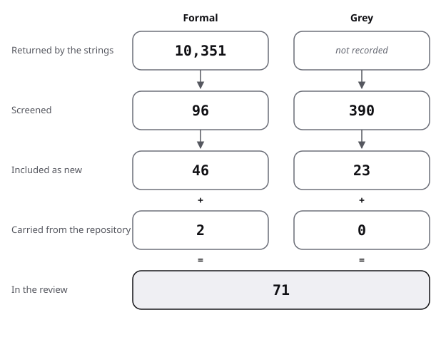

# Sources: the pool, the flow and the scores

Here is the pool of the system-design review: how it narrowed, then one row per source with kind, route found, quality and use. Method and strings are in [protocol](protocol.md).

## Flow

| Stage | Formal | Grey |
|---|---|---|
| Returned by the strings | 10,351 | not recorded |
| Screened | 96 | 390 |
| Included as new | 46 | 23 |
| Carried from the repository | 2 | 0 |
| In the review | 48 | 23 |

- Formal:
  - 10,351 records were counted by the strings (Semantic Scholar 8,481; arXiv 1,870), noisy upper bounds.
  - 96 were screened: 32 titles in API listings, 25 named works checked against Crossref, and 1 found by a web search.
  - In the second pass 38 more were screened: 5 named by the coordinator, 25 forward-citing titles, 7 backward titles and references, and 1 named in a source.
  - 46 were included as new: 20 leads (14 from the brief, 5 named in the second pass, and Brooker 2025) and 9 found by search.
  - The other 17 were 10 known to the reviewer and checked in Crossref, and 7 found by snowballing.
  - Bogli 2024 and Newcombe 2015 were already in the repository.
  - Most of the counted records were not read: the strings count words, not phrases.
- Grey:
  - Q/A strings returned 380 records; web search pages are not counted.
  - 390 were screened (380 Q/A titles, 10 producer pages read).
  - 23 were included: 9 web pages, 14 Q/A threads.
  - Located and not scored (books, standards, repositories and two preprints), listed below: 9; not counted in the totals.
- Excluded, rounded:
  - Q/A records not included, judged by title: about 366;
  - web search results not relevant (energy, agriculture, hardware architecture): not counted;
  - forward-citing records not taken: about 75 of the 100 on the first page (application papers, education, unrelated uses of AWS).
- Snowballing, second pass (details in [protocol](protocol.md)): backward from Yuan 2014, Alquraan 2018 and Lampson 2020; forward from Newcombe 2015, first 100 citing records.
- Existing reviews found: 7, in review.md strand 0.
- Reach of the formal sources: 2 are title and venue only (Nuseibeh 2001, Rabkin 2013). Nuseibeh 2001 was tried and could not be retrieved. Bloch 2006, Brooker 2025, Stylos 2008, Gill 2011 and Ellis 2007 were later read in full.

The figure draws the stages of the table for system design.

## Formal sources

"Found via" takes four values.

- "lead": named in the brief or by the coordinator and verified.
- "search": found by a string or web search.
- "known": named by the reviewer and verified in Crossref.
- "snowball": found by backward or forward snowballing.

| Key | Kind | Found via | Quality | Used in |
|---|---|---|---|---|
| Saltzer 1984 | formal | lead | argument; abstract, introduction and argument read | review 1 |
| Lampson 1983 | formal | lead | experience; full text read | review 1 |
| Lampson 2020 | formal | lead | revision; abstract, contents and a text scan read | review 1 |
| Gilbert 2002 | formal | lead | theory; abstract and introduction read | review 2 |
| Brewer 2012 | formal | lead | argument; full text read in a republication | review 2 |
| Abadi 2012 | formal | lead | argument; first page and the PACELC section read | review 2 |
| Kleppmann 2015 | formal | lead | critique; abstract and background read | review 2 |
| Viotti 2016 | formal | lead | survey; abstract read | review 0 |
| Yuan 2014 | formal | lead | measured, descriptive; full text read | review 3 |
| Alquraan 2018 | formal | lead | measured, descriptive; full text read | review 3, 6 |
| Gunawi 2014 | formal | lead | measured, descriptive; abstract and introduction read | review 3 |
| Gunawi 2016 | formal | lead | measured, descriptive; abstract and root-cause sections read | review 3 |
| Gunawi 2018 | formal | lead | measured, descriptive; abstract read | review 3 |
| Huang 2017 | formal | lead | experience report; abstract read | review 3 |
| Liu 2019 | formal | lead | measured, descriptive; abstract read | review 3 |
| Myers 2016 | formal | lead | summary article; submitted version read | review 5 |
| Bloch 2006 | formal | lead | talk abstract of design maxims; full text read | review 5 |
| Nuseibeh 2001 | formal | lead | argument (the Twin Peaks model); read in full | review 7 |
| Brooker 2025 | formal | lead | practice report; full text read (an owner's report) | review 6 |
| Bornholt 2021 | formal | lead | practice report with counts; full text read (an owner's report) | review 6 |
| Li 2013p | formal | search | systematic survey; abstract read | review 0 |
| Owotogbe 2025 | formal | search | multivocal review; abstract read, 96 sources | review 0 |
| Costa 2025 | formal | search | multivocal review; abstract and method read | review 0 |
| Rauf 2019 | formal | search | systematic mapping, 47 studies; abstract read | review 0, 5 |
| Machini 2024 | formal | search | mapping study; abstract read | review 0, 5 |
| Kotstein 2021 | formal | search | measured, descriptive, 8 experts; abstract read | review 5 |
| Murphy 2017 | formal | search | guideline analysis; search summary (secondary) | review 5 |
| Cheng 2026 | formal | search | benchmark, preprint; abstract read | review 11 |
| Sahu 2026 | formal | search | argument with a tool, preprint; abstract read | review 11 |
| Bailis 2014 | formal | known | survey of reported cases; companion post read, article not reached | review 3 |
| Bailis 2012 | formal | known | measured and modelled; full text read | review 2 |
| Dean 2013 | formal | known | argument with one measured table; full text read | review 4 |
| Zhou 2021 | formal | known | system paper; abstract and simulation section read | review 6 |
| Hackett 2023 | formal | known | industrial report; abstract read | review 6 |
| Ellis 2007 | formal | known | user study, 12 participants; full text read (the authors' copy) | review 5 |
| Stylos 2007 | formal | known | user study, 30 programmers, no statistical test; full text read | review 5 |
| Piccioni 2013 | formal | known | measured, descriptive, 25 programmers; full text read | review 5 |
| Murphy 2018 | formal | known | measured, descriptive, 24 interviews; abstract read | review 5 |
| Elm 2012 | formal | known | survey; abstract read | review 7 |
| Stylos 2008 | formal | snowball | user study, 10 participants; full text read | review 5 |
| Rabkin 2013 | formal | snowball | failure study; title and venue only | review 3 |
| Gill 2011 | formal | snowball | failure study, one year of logs; full text read | review 3 |
| Fonseca 2017 | formal | snowball | measured, descriptive; abstract read | against |
| ter Beek 2024 | formal | snowball | survey; abstract read | review 6 |
| Cirstea 2024 | formal | snowball | method paper; abstract read | review 6 |
| Tang 2024 | formal | snowball | method paper; abstract read | review 6 |
| Newcombe 2015 | formal | carried | owner's report; preprint read, re-read for design content | review 6 |
| Bogli 2024 | formal | carried | systematic review; full text read | review 0, 6 |

## Grey sources, scored

Subtotals run authority, methodology, objectivity, date, position, novelty, impact, outlet, in the order the [method](../README.md#method) note gives. A source under 10 is an example of practice only. The Q/A scoring rules for these sources are in [protocol](protocol.md). The Stack Exchange keys of these sources use letters from p, to avoid keys taken by parallel topics.

| Key | Kind | Found via | Quality (total, then subtotals) | Used in |
|---|---|---|---|---|
| Brewer 2000 | grey tier 2 | lead | 14.5 of 20 (4 / 2 / 3 / 1 / 1 / 2 / 1 / 0.5) | review 2 |
| Beyer 2016 | grey tier 1 | direct visit | 14.5 of 20 (4 / 3.5 / 2.5 / 0.5 / 0.5 / 1.5 / 1 / 1) | review 9 |
| Primer 2026 | grey tier 2 | direct visit | 12 of 20 (1.5 / 3 / 3.5 / 1 / 0.5 / 1 / 1 / 0.5) | review 4, 8, 9 |
| AWS 2026p | grey tier 1 | direct visit | 10 of 20 (3 / 2 / 1.5 / 0.5 / 0.5 / 0.5 / 1 / 1) | review 9 |
| Azure Patterns 2026 | grey tier 1 | direct visit | 11 of 20 (3 / 2.5 / 2 / 1 / 0.5 / 0.5 / 0.5 / 1) | review 9 |
| Google AIP 2025 | grey tier 2 | direct visit | 15 of 20 (4 / 4.5 / 2.5 / 1 / 0.5 / 1 / 1 / 0.5) | review 9 |
| Zalando 2026 | grey tier 2 | direct visit | 13.5 of 20 (3.5 / 4 / 2.5 / 0.5 / 1 / 1 / 0.5 / 0.5) | review 9 |
| Microsoft API 2026 | grey tier 2 | direct visit | 11.5 of 20 (3.5 / 3 / 2 / 0.5 / 0.5 / 0.5 / 1 / 0.5) | review 9 |
| Jepsen 2026 | grey tier 2 | direct visit | 16.5 of 20 (3.5 / 5 / 3 / 1 / 0.5 / 2 / 1 / 0.5) | review 9 |
| SO 2012p | grey tier 2 | SY14 | 15.5 of 20 (2 / 4.5 / 4 / 1 / 1 / 1.5 / 1 / 0.5) | review 10 |
| SO 2012q | grey tier 2 | SY15 | 12.5 of 20 (1.5 / 3 / 4 / 1 / 0.5 / 1 / 1 / 0.5) | review 10 |
| SO 2012r | grey tier 2 | SY14 | 14 of 20 (1 / 4 / 4 / 1 / 1 / 1.5 / 1 / 0.5) | review 10 |
| SO 2016p | grey tier 2 | SY14 | 14 of 20 (1.5 / 4.5 / 4 / 1 / 0.5 / 1 / 1 / 0.5) | review 10 |
| SO 2014p | grey tier 2 | SY13 | 11 of 20 (1 / 2.5 / 4 / 1 / 0.5 / 0.5 / 1 / 0.5) | review 8 |
| SESE 2013p | grey tier 2 | SY2 | 14.5 of 20 (1.5 / 4.5 / 4 / 1 / 0.5 / 1.5 / 1 / 0.5) | review 10 |
| SESE 2017p | grey tier 2 | SY3 | 14.5 of 20 (1.5 / 4.5 / 4 / 1 / 0.5 / 1.5 / 1 / 0.5) | review 10 |
| SESE 2011p | grey tier 2 | SY4 | 13 of 20 (1.5 / 3.5 / 4 / 1 / 0 / 1.5 / 1 / 0.5) | review 8 |
| SESE 2018p | grey tier 2 | SY4 | 11.5 of 20 (1.5 / 3 / 4 / 1 / 0 / 1 / 0.5 / 0.5) | review 4, 10 |
| SESE 2016p | grey tier 2 | SY12 | 11 of 20 (1 / 3 / 4 / 1 / 0 / 1 / 0.5 / 0.5) | review 10 |
| SESE 2013q | grey tier 2 | SY3 | 14.5 of 20 (2 / 3.5 / 4 / 1 / 1 / 1.5 / 1 / 0.5) | review 10 |
| SESE 2015p | grey tier 2 | SY17 | 12.5 of 20 (1 / 4 / 4 / 1 / 0 / 1 / 1 / 0.5) | review 10 |
| SESE 2022p | grey tier 2 | SY9 | 12.5 of 20 (2 / 3 / 4 / 1 / 0.5 / 1.5 / 0 / 0.5) | review 8 |
| SESE 2014p | grey tier 2 | SY8 | 15.5 of 20 (2.5 / 4.5 / 4 / 1 / 1 / 1 / 1 / 0.5) | review 10 |

## Located, not scored

Opened only as a listing, or not opened; cited for what the publisher or a listing says, and marked so in the text.

| Key | Why not scored |
|---|---|
| Kleppmann 2017 | practitioner book, not opened |
| ISO 2023b | standard, paid, not opened; edition and clause numbers from the publisher listing |
| ISO 2019 | standard, paid, not opened |
| INCOSE 2023 | handbook, not opened; edition and length from retailer listings |
| Saltzer 2009 | textbook, not opened |
| ByteByteGo 2023 | repository seen only as a star count |
| SysDesign Bench 2026 | benchmark page found by search, not read |
| Jiang 2023b | planning before code, linked to algorithm-design; abstract read, not reviewed here |
| Schmid 2025 | review of architecture design with models, located and left to architecture-design |

## Result of the scoring

- 23 grey sources scored: 9 web, 14 Q/A threads; none falls below 10 of 20.
- AWS 2026p scores exactly 10 and is the weakest; it reports its own product.
- The highest are Jepsen 2026 (16.5), SO 2012p and SESE 2014p (15.5), and Google AIP 2025 (15).
- The Q/A threads repeat the pool on two points: CAP is asked as a binary choice, and estimation starts from requirements.
- One reviewer scored everything; no second rater.
