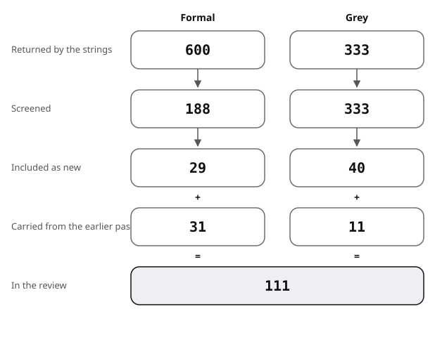

# Sources: the pool of the multivocal review of system diagrams

This file lists how many sources each search found, screened and included, and gives one row per included source with its quality. Searches and rules are in [protocol](protocol.md).

## Flow

| Stage | Formal | Grey |
|---|---|---|
| Returned by the strings | 600 | 333 |
| Screened | 188 | 333 |
| Included as new | 29 | 40 |
| Carried from the earlier pass | 31 | 11 |
| In the review | 60 | 51 |

- Formal:
  - 17 strings were run in Semantic Scholar, 8 of them also in OpenAlex.
  - 600 hits were returned and 188 screened.
  - Included as new is 29: 16 from the strings and 13 from the web search, snowballing or the arXiv check.
  - 31 were carried from the earlier narrative pass.
- Grey:
  - 10 web strings and 12 Q/A strings (SD1 to SD12) were run.
  - 333 results were returned and screened (113 web, 220 Q/A).
  - Included as new is 40: 8 from the web strings, 2 from the web search or snowballing, and 30 Q/A threads (29 first met in an SD string, 1 in an AD string).
  - 11 were carried from the earlier narrative pass.

In the review: the system diagrams source rows of each kind, counted by script.

The figure draws the stages of the table for system diagrams.

- The 16 reviews of review.md strand 0 are inside the formal 60.
- Excluded, by main reason (not tallied per hit):
  - not about diagrams read by a person (test and code generation, other fields, plant biology for "C4");
  - teaching tools and duplicates across strings;
  - for grey, vendor articles with no author or date.
- Grey sources not used because the text could not be read: Google Cloud icon library page, a Leanpub book page, a vendor modelling guide.
- Formal sources found and not read are listed below with "not read"; none supports a claim.
- The 51 grey sources were scored (21 from the web and the narrative pass, 30 Q/A threads); 11 fall below 10 of 20 and stay only as examples of practice. Two of the 11 are Q/A threads, SESE 2017f and SO 2014c; SO 2012a, SO 2012b and SESE 2020a sit at exactly 10 and stay in.
- The Q/A threads mostly repeat the practice strands. SESE 2012j restates that UML is used selectively. The Q/A volume on the C4 model, diagrams as code and PlantUML was tiny (`title=PlantUML` found 1 thread, `title=diagram code` none), so these sites say little about the adoption of the newer tools.
- SESE 2022a, SESE 2012h, SESE 2011h, SESE 2017f and SO 2016a are cited only in the table below.

## Column keys

- Grey quality is the total out of 20, then the eight subtotals: authority (max 4), methodology (6), objectivity (4), date (1), position (1), novelty (2), impact (1), outlet tier (1).
- Formal quality is the evidence grade of the study type; "secondary" means the number was read in an abstract or another paper.

## Pool

| Key | Kind | Found via | Quality | Used in |
|---|---|---|---|---|
| Moody 2009a | formal | narrative pass | convention (theory); abstract read | review 1 |
| Moody 2009b | formal | narrative pass | convention; analysis without participants | review 1 |
| Moody 2010 | formal | narrative pass | convention; analysis without participants (abstract read) | review 1 |
| van der Linden 2019 | formal | narrative pass | review of 70 applications; abstract read | review 0, 1 |
| Störrle 2013 | formal | narrative pass | supported with caveat; abstract read | review 1 |
| Green 1996 | formal | narrative pass | convention | review 1 |
| Blackwell 2003 | formal | narrative pass | convention | review 1 |
| Budgen 2011 | formal | narrative pass | review of 49 publications; secondary | review 0 |
| Arisholm 2006 | formal | narrative pass | measured; abstract read | review 2 |
| Scanniello 2018 | formal | narrative pass | measured, meta-analysis of 12 experiments; full text read | review 2 |
| Fernández-Sáez 2014 | formal | narrative pass | not read; supports no claim | review 2 |
| Störrle 2011 | formal | narrative pass | measured; students, one group; primary | review 2, baseline |
| Störrle 2014 | formal | narrative pass | measured; re-analysis of the 2012 data; primary | review 2, baseline |
| Störrle 2016 | formal | narrative pass | measured; re-analysis of the 2012 data; primary | review 2 |
| Purchase 2002 | formal | narrative pass | supported with caveat; secondary | review 3 |
| Eichelberger 2009 | formal | narrative pass | not read; quoted in Störrle 2014 | review 3 |
| Ware 2002 | formal | narrative pass | measured; secondary | review 3, baseline |
| Yusuf 2007 | formal | narrative pass | measured, small; secondary | review 3 |
| Sharif 2010 | formal | narrative pass | measured, 15 participants; abstract read | review 3, baseline |
| Cepeda Porras 2010 | formal | narrative pass | not read; supports no claim | review 3 |
| Cherubini 2007 | formal | narrative pass | measured, descriptive; secondary | review 4 |
| Baltes 2014 | formal | narrative pass | measured, descriptive; abstract read | review 4 |
| Petre 2013 | formal | narrative pass | measured, descriptive; secondary | review 4 |
| Dobing 2006 | formal | narrative pass | measured, descriptive; secondary | review 4 |
| Störrle 2017 | formal | narrative pass | measured, descriptive; secondary | review 4 |
| Ozkaya 2020 | formal | narrative pass | measured, descriptive; full text read | review 4 |
| Hebig 2016 | formal | narrative pass | measured, descriptive; secondary | review 4 |
| Ho-Quang 2017 | formal | narrative pass | measured, descriptive; secondary | review 4 |
| Koning 2002 | formal | narrative pass | supported with caveat; guidelines tested on three groups; secondary | review 4 |
| Schneider 2024 | formal | narrative pass | measured, 24 participants; abstract read | review 5 |
| Sion 2018 | formal | narrative pass | convention; secondary | review 5 |
| Pretorius 2008 | formal | string 1, 3 | review of 33 papers; abstract read | review 0 |
| Fernández-Sáez 2013 | formal | string 3, forward snowball | review of 38 papers; full text read | review 0 |
| Guo 2017 | formal | string 1, 2 | review; abstract not available, not read | review 0 |
| Koç 2021 | formal | string 2, web search | review of 128 papers; abstract read | review 0 |
| Baldassarre 2019 | formal | forward snowball (Budgen 2011) | review; abstract read | review 0 |
| Alhazmi 2026 | formal | forward snowball (Störrle 2011, Budgen 2011) | review of 26 studies; abstract read | review 0 |
| Dikici 2018 | formal | forward snowball (Störrle 2011), web search | review of 45 studies; full text read | review 0, 2 |
| Houy 2012 | formal | web search | review; summary read (secondary) | review 0 |
| Shahin 2014 | formal | web search | review of 53 papers; full text read | review 0 |
| Chotisarn 2020 | formal | web search | review of 105 papers; abstract read | review 0 |
| Merino 2018 | formal | web search | review of 181 papers; abstract read | review 0 |
| Filho 2019 | formal | string 4, web search | mapping study; abstract not available, not read | review 0 |
| Obaidellah 2018 | formal | string 3, 10 | review of 63 studies, programming; abstract read | review 0 |
| Rahmanian 2026 | formal | web search | review of 64 studies; abstract and introduction read | review 0 |
| Störrle 2012 | formal | forward snowball (Störrle 2011) | measured; not read, described in Störrle 2014 and 2016b | review 2 |
| Störrle 2016b | formal | web search, forward snowball | measured; pools the 2011 and 2012 data, 156 participants; primary | review 2, baseline |
| Santos 2018 | formal | forward snowball (Moody 2009a, Störrle 2011), web search | measured, quasi-experiment, 57 novices; primary (preprint) | review 1 |
| van der Linden 2018 | formal | string 5 | descriptive survey, 104 responses; secondary | review 1 |
| Guerreiro 2023 | formal | arXiv check (physics of notations) | convention; used for the nine principles | review 1 |
| Nicacio 2022 | formal | web search, arXiv check | descriptive survey, 34 respondents; primary | review 4 |
| Jongeling 2025 | formal | string 13 | descriptive survey, 48 respondents; primary | review 5, baseline |
| Mavrogiorgou 2025 | formal | string 13 | case description, no reader measure; abstract read | review 5 |
| Jokste 2024 | formal | string 13 | case description, no reader measure; abstract read | review 5 |
| Mbaka 2024 | formal | string 11 | registered report, no results; abstract page read | review 5 |
| Mangano 2015 | formal | string 14 | not read; supports no claim | review 4 |
| Byelas 2006 | formal | string 8 | not read; supports no claim | review 3 |
| Sharif 2009a | formal | string 7 | not read; supports no claim | review 3 |
| Sharif 2009b | formal | string 10 | not read; supports no claim | review 3 |
| Soh 2012 | formal | string 10 | not read; supports no claim | review 3 |
| OMG 2017 | grey tier 1 | narrative pass | 15.5/20 (4/4/2.5/1/1/1/1/1) | review 5, baseline |
| OMG 2024 | grey tier 1 | narrative pass | 11.5/20 (4/1.5/2.5/1/0/0.5/1/1) | review 5 (landing page only) |
| Brown 2026b | grey tier 2 | narrative pass | 9/20 (3/2/1/0/0/1.5/1/0.5) **below 10: example of practice only** | review 5, baseline |
| Brown 2026d | grey tier 2 | snowball from Brown 2026b | 8/20 (3/2/1/0/0/1/0.5/0.5) **below 10: example of practice only** | review 5, baseline |
| Brown 2026c | grey tier 2 | G9 | 9/20 (3/2.5/1.5/0/0/1/0.5/0.5) **below 10: example of practice only** | review 5 |
| Brown 2021 | grey tier 2 | G10 | 10/20 (3.5/2.5/1/0.5/0/1.5/0.5/0.5) | review 5 (abstract page only) |
| IcePanel 2023 | grey tier 3 | G2 | 5/20 (0.5/2/1/1/0/0.5/0/0) **below 10: example of practice only** | review 5 |
| GitHub 2022 | grey tier 3 | narrative pass | 11.5/20 (3.5/3.5/1.5/1/0.5/1/0.5/0) | review 5, baseline |
| Mermaid 2026 | grey tier 2 | narrative pass | 10/20 (2/2/3/1/0/0.5/1/0.5) | review 5 |
| PlantUML 2026 | grey tier 2 | narrative pass (count) | 10/20 (2/2/3/1/0/0.5/1/0.5) | review 5 |
| D2 2026 | grey tier 2 | narrative pass (count) | 10/20 (2/2/3/1/0/0.5/1/0.5) | review 5 |
| npm 2026 | grey tier 2 | narrative pass | 9.5/20 (2/2/3/1/0/0.5/0.5/0.5) **below 10: example of practice only** | review 5 |
| Mermaid 2026b | grey tier 2 | snowball from Fuchsia 2025 | 7.5/20 (3/1.5/1/0/0/0.5/1/0.5) **below 10: example of practice only** | review 5 |
| AWS 2026 | grey tier 2 | narrative pass | 8.5/20 (3/2/1.5/0.5/0/0.5/0.5/0.5) **below 10: example of practice only** | review 5 |
| AWS 2026b | grey tier 2 | narrative pass | 12.5/20 (3/5/1.5/0.5/0.5/1/0.5/0.5) | review 5, baseline |
| Wikipedia 2026b | grey tier 2 | narrative pass | 10/20 (0.5/2.5/3.5/1/1/0/1/0.5) | review 5 |
| Microsoft 2026 icons | grey tier 2 | G3 | 10/20 (2.5/3/1.5/1/0.5/0.5/0.5/0.5) | review 5 |
| Microsoft 2023 | grey tier 2 | G4 | 11.5/20 (2.5/4/1.5/1/0.5/1/0.5/0.5) | review 5 |
| OWASP 2026 | grey tier 2 | G7 | 11.5/20 (3.5/2.5/2.5/0/0.5/1/1/0.5) | review 5 |
| Fuchsia 2025 | grey tier 2 | G5 | 9/20 (1.5/3.5/1.5/1/0/0.5/0.5/0.5) **below 10: example of practice only** | review 5 |
| GitLab 2026 | grey tier 2 | G5 | 8/20 (1.5/3.5/1.5/0/0/0.5/0.5/0.5) **below 10: example of practice only** | review 5 |
| SESE 2011g | grey tier 2 | SD1 | 13/20 (1.5/4/4/1/0/1/1/0.5) | review 4 |
| SESE 2012g | grey tier 2 | SD3 | 13/20 (1.5/4/4/1/0/1.5/0.5/0.5) | review 5 |
| SESE 2017d | grey tier 2 | SD6 | 15/20 (2/5/4/1/0/2/0.5/0.5) | review 5 |
| SESE 2020a | grey tier 2 | SD8 | 10/20 (0.5/2/4/1/0/2/0/0.5) | review 5 |
| SESE 2017e | grey tier 2 | SD3 | 12.5/20 (1/5/3/1/0/2/0/0.5) | review 5 |
| SESE 2019b | grey tier 2 | SD3 | 14.5/20 (2/5/4/1/0/2/0/0.5) | review 5 |
| SESE 2017f | grey tier 2 | SD3 | 9.5/20 (1.5/1/4/1/0/1/0.5/0.5) **below 10: example of practice only** | sources only |
| SESE 2015d | grey tier 2 | SD2 | 15/20 (2.5/4/4/1/0.5/2/0.5/0.5) | review 4, against |
| SESE 2012h | grey tier 2 | SD2 | 15.5/20 (2.5/4.5/3.5/1/0.5/2/1/0.5) | sources only |
| SESE 2015e | grey tier 2 | SD2 | 16/20 (2.5/4.5/4/1/0.5/2/1/0.5) | review 4, against |
| SESE 2015f | grey tier 2 | SD2 | 16/20 (2.5/5/4/1/1/1.5/0.5/0.5) | review 5 |
| SESE 2022a | grey tier 2 | SD2 | 15/20 (1/5/4/1/0.5/2/1/0.5) | sources only |
| SESE 2012i | grey tier 2 | SD2 | 15/20 (2/5/4/1/0/1.5/1/0.5) | review 4, against |
| SESE 2017g | grey tier 2 | SD2 | 13.5/20 (1.5/4/4/1/0/2/0.5/0.5) | review 4, against |
| SESE 2012j | grey tier 2 | SD2 | 14/20 (1.5/4.5/4/1/0/2/0.5/0.5) | sources only |
| SESE 2011h | grey tier 2 | SD2 | 13/20 (1.5/4.5/4/1/0/1/0.5/0.5) | sources only |
| SESE 2010g | grey tier 2 | SD2 | 14.5/20 (1/5/4/1/0/2/1/0.5) | review 4, against |
| SESE 2011i | grey tier 2 | SD2 | 15.5/20 (2/5/4/1/0/2/1/0.5) | review 4 |
| SESE 2013c | grey tier 2 | SD2 | 14/20 (2/3.5/4/1/0.5/2/0.5/0.5) | review 4 |
| SESE 2023a | grey tier 2 | SD3 | 12/20 (1/4/4/1/0/1.5/0/0.5) | review 4, against |
| SESE 2024a | grey tier 2 | SD5 | 13.5/20 (2/4/4/1/0/2/0/0.5) | position |
| SESE 2011j | grey tier 2 | SD2 | 13.5/20 (1.5/3.5/4/1/0.5/2/0.5/0.5) | review 4 |
| SO 2021b | grey tier 2 | SD1 | 11.5/20 (0.5/3/4/1/0/2/0.5/0.5) | position |
| SO 2014c | grey tier 2 | SD1 | 9/20 (0.5/2.5/3/1/0/1/0.5/0.5) **below 10: example of practice only** | position |
| SO 2012a | grey tier 2 | SD1 | 10/20 (2/2/3/1/0/1/0.5/0.5) | position |
| SO 2016a | grey tier 2 | AD7 (other topic's string) | 11.5/20 (2/3.5/3/1/0/1/0.5/0.5) | sources only |
| SO 2012b | grey tier 2 | SD4 | 10/20 (1.5/2.5/3.5/1/0/1/0/0.5) | review 5 |
| SO 2009d | grey tier 2 | SD5 | 14/20 (2/3/4/1/0.5/2/1/0.5) | position |
| SO 2011c | grey tier 2 | SD5 | 16.5/20 (1.5/5.5/4/1/1/2/1/0.5) | position |
| SO 2010b | grey tier 2 | SD5 | 14.5/20 (1.5/4.5/3.5/1/0.5/2/1/0.5) | position |
