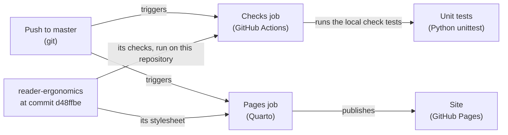

# Shape: system diagram

This shape draws the structure of a system so a reader answers structural questions quickly and without error: who
calls whom, what contains what, what runs where. Each diagram it shapes has:

- a title that says its type and scope, and a key;
- typed elements, and one-way arrows labelled with what they carry;
- its source as text beside the picture, so the two change together.

## When to use it

- Inside an [architecture description](architecture-description.md), for its context, its parts, its runtime and its
  deployment: one diagram per view.
- In a [design document](design-document.md), to show the design a reviewer must judge.
- Not for the steps of one algorithm: that is the pseudocode of an [algorithm specification](algorithm-specification.md).

## How each part maps to the evidence

| Part | What it does | Evidence | Grade |
|---|---|---|---|
| Title with type and scope | says which view this is, of what | C4 notation rules (Brown 2026b) and its review checklist (Brown 2026d); IcePanel 2023 | convention, untested; the pages score below 10 of 20 |
| Key | says what each shape, line and colour means | Brown 2026b. With a key present, a clearer symbol set gave no gain in accuracy or speed, in 57 novices (Santos 2018, measured, one study) | convention, untested; no study compares a key with none |
| Typed elements | each element names its type, and each container its technology | Brown 2026b | convention, untested |
| Labelled one-way arrows | each arrow says what it carries and how | Brown 2026b; Microsoft 2023 for data flows. Readers ask what an arrow means, in threads with thousands of views (system-diagrams review, position) | convention, untested |
| Few layout flaws | crossings, bends and overlaps kept rare | flaws weigh more than size on readers' performance (Störrle 2016b, measured, one research group) | measured, one group |
| Size near the centre | about 44 to 65 elements, fewer for novices | the centre differs by data set, so it is no threshold (Störrle 2016b) | measured, one group |
| Compound layout | related elements grouped, paths straight | good layout raised clarity ratings and sped correct answers (Störrle 2011; Ware 2002) | measured, small accuracy gains |
| Colour for kind only | consistent, legible in grayscale, never the only signal | Brown 2026b; Fuchsia 2025 | convention, untested |
| Source as text | the diagram's source kept beside the picture | Mermaid renders natively on GitHub (GitHub 2022); engineers in one company judged text-defined diagrams successful and missed layout control (Jongeling 2025) | adoption, measured, descriptive |
| Legible at small width | readable at about 700 pixels, contrast of 4.5 to 1, alt text | AWS 2026b; the contrast floor of reader-ergonomics | convention; the floor is a standard |

- Notation design: visual notations should follow cognitive principles (Moody 2009a). Its applications are rarely
  verified, which makes it a convention to apply with care.
- Most diagrams in practice are informal boxes and lines (Baltes 2014, measured, descriptive); that is the third
  baseline a rule must beat.
- No controlled study compares C4 with UML, icon sets with plain boxes, or a key with none. The
  [baseline](../evidence/system-diagrams/baseline.md) names the comparison.

## The principles it applies

| Part | Principle |
|---|---|
| The diagram itself, with text beside it | [draw relations](https://github.com/Tewf/reader-ergonomics/blob/d48ffbe96aed32dd63e1974ee60f69472fe36932/principles/page/draw-relations.md) |
| Key and explanation next to the picture | [figure next to its text](https://github.com/Tewf/reader-ergonomics/blob/d48ffbe96aed32dd63e1974ee60f69472fe36932/principles/page/figure-next-to-its-text.md) |
| Contrast of 4.5 to 1 | [sufficient contrast](https://github.com/Tewf/reader-ergonomics/blob/d48ffbe96aed32dd63e1974ee60f69472fe36932/principles/page/sufficient-contrast.md) |

## The skeleton

````markdown
**<Type> diagram: <scope>.** <One sentence: what the diagram answers.>

```mermaid
<the source, one element or arrow per line, each arrow labelled>
```

| Key | Meaning |
|---|---|
| box | <element type>, with its technology |
| arrow | <what flows, and how>, in the direction it points |

<Alt text: the same structure in one or two sentences.>
````

## The rules

1. The title names the diagram's type and scope; the first sentence says what it answers.
2. Every diagram has a key, even when the notation seems obvious.
3. Each element shows its type, and a container its technology.
4. Arrows point one way and carry a label: what flows, and over what.
5. Keep layout flaws rare; when a diagram grows past about fifty elements, split it by scope rather than shrink it.
6. Colour marks kind only, the same kind in the same colour across a document, and never alone.
7. The source is text, kept beside the picture, so a change to the system changes both.
8. Alt text says the structure in words, for a reader who cannot see the picture.

## Worked example

**Runtime diagram: how this repository is checked and published.** It answers what runs on a push, in what order, and
what each step uses.



| Key | Meaning |
|---|---|
| box | an event, a job or a repository, with its technology in brackets |
| arrow | what one element gives the next, in the direction of the arrow |

Alt text: a push to master triggers two jobs. The checks job takes reader-ergonomics at commit d48ffbe and runs its
checks; then it runs this repository's own tests. The Pages job uses the same commit's stylesheet and publishes the site.
