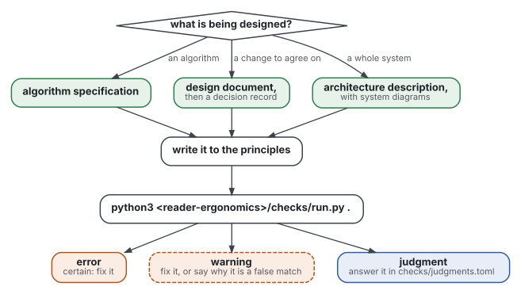
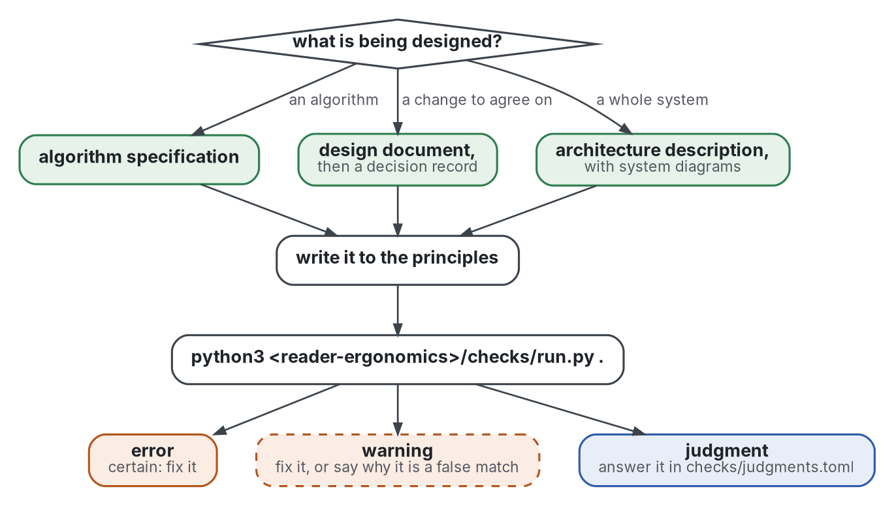

# The software design standard

What designing software before the code shares, as far as the evidence goes: the rules for an algorithm's
specification, a design document, a decision record, an architecture description and a diagram. It extends
[reader-ergonomics](https://github.com/Tewf/reader-ergonomics/blob/bfbe9f7ed27bfdca0c6a4922d0b3e302f9e55d3f/standard.md), the standard for any reader: read that one first. This page adds only what
software design changes, since its reader is often an implementer, a person or a model, who builds from the text.

## How to use it

Graphviz source

1. **Pick the shape** from [shapes/](shapes/README.md), and name it in the document with a `**Shape:**` line that
   links it; the checks find their documents by that line.
2. **Write to the principles** below, and to those of reader-ergonomics, which still hold.
3. **Check:** copy `checks/local/` into your repository and run the standard's checks. `algorithm-specs` and
   `design-docs` find each document by its Shape line and check it against its shape; `diagram-keys` checks every
   Mermaid diagram; `decision-records`, in the standard, checks the records.

Grades mean what they mean in [reader-ergonomics](https://github.com/Tewf/reader-ergonomics/blob/bfbe9f7ed27bfdca0c6a4922d0b3e302f9e55d3f/standard.md#grades): measured, supported with caveat,
convention, not supported. Each principle states its grade and never claims more.

## Principles

<!-- principles:start -->

### Specification: before the code is written

| Principle | Claim | Grade |
|---|---|---|
| [Code-like steps](principles/specification/code-like-steps.md) | an algorithm's steps are written as constrained, code-like pseudocode, one statement per line, not as prose. | measured, in old and small experiments |
| [Contract before steps](principles/specification/contract-before-steps.md) | an algorithm's specification states its contract before its steps: the precondition the caller ensures, and the postcondition the code ensures. | convention, untested for the order; measured, observational and small for contracts in code |
| [Examples and properties as tests](principles/specification/examples-as-tests.md) | a specification handed to an implementer, a person or a model, carries examples with their expected outputs, edge cases first, and properties that hold for every valid input. | measured, on model benchmarks; convention, untested for people |

### Decision: proposing a design and keeping the choice

| Principle | Claim | Grade |
|---|---|---|
| [The decision asked comes first](principles/decision/decision-asked-first.md) | a design document opens with the decision it asks of the reviewer, before the motivation. | convention, untested (a hypothesis to test) |
| [Design the failure paths](principles/decision/design-the-failure-paths.md) | a design names how each part fails and how each failure is handled, and its plan tests those paths. | measured, descriptive (failure studies), for where failures come from; convention, untested for the document that names them |
| [Keep the options that lost](principles/decision/keep-the-options-that-lost.md) | a decision record lists every option considered, the chosen one included, with its consequences and why the others lost. | convention, adopted; one writer-side experiment |

### Structure: describing and drawing a system

| Principle | Claim | Grade |
|---|---|---|
| [Order a description by the reader's questions](principles/structure/by-the-readers-questions.md) | an architecture description follows its readers' questions, in order: its readers, the system's surroundings, its parts, its invariants, its runtime and deployment, and its reasons. | convention, untested; the one controlled experiment found no effect of the structure |
| [Every diagram has a key, every arrow a label](principles/structure/diagram-key-and-labels.md) | every diagram of a system has a key, and every arrow says what it carries, in the direction it points. | convention, untested |

<!-- principles:end -->

## Where the evidence is

Every principle links its review in [evidence/](evidence/README.md), and every work cited is listed once in the
[bibliography](evidence/bibliography.md).
